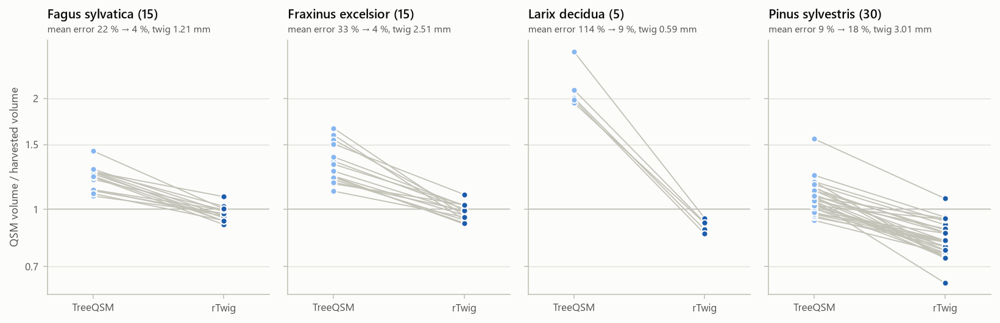
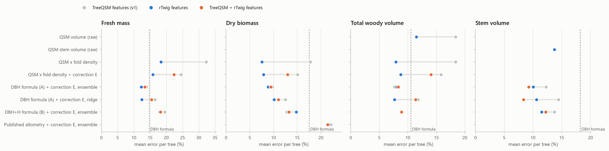

# v1.1 — rTwig-corrected QSMs

**Status:** done · **Parent:** [v1-residuals](../v1-residuals/) · **Code:** tag `v1.1` ·
**Full tables:** [tables.md](tables.md)

## Question

v1 found that TreeQSM cylinder models overestimate harvested woody volume by about 25 %, by
an amount that depends on species (about 2x for larch). Most of the excess is in thin
branches, where TreeQSM fits radii to few, noisy points. rTwig is an R package that corrects
those radii. Two questions:

1. Is rTwig-corrected QSM volume a better estimate of harvested volume on its own?
2. Are corrected QSM features better inputs for the residual correction on sites the model
   has never seen?

## What rTwig does

rTwig sets the radius at every branch tip to a measured twig radius for the species. It then
fits a taper model along each path from tip to stem base and replaces fitted radii that
disagree with it. Stem radii change little; thin-branch radii shrink.

## Setup

- **Same as v1:** the 65 Belgian harvested trees, the four targets (fresh mass, dry biomass,
  total and stem woody volume), both input scenarios (field or scan DBH and height), both
  cross-validation schemes (leave-one-site-out, within-site 5-fold), the learners and their
  settings. Definition: [config.yaml](config.yaml), which reads the rest from the
  [v1 config](../v1-residuals/config.yaml).
- **One change:** where the QSM structure features (feature set E) and the QSM baselines
  come from.

  | Source | QSM features |
  |---|---|
  | TreeQSM | TreeQSM radii, exactly as v1 |
  | rTwig | rTwig-corrected radii in place of TreeQSM's |
  | TreeQSM + rTwig | v1's TreeQSM features plus two more: corrected branch volume, and the log ratio of corrected to uncorrected total volume (how much rTwig removed) |

  DBH, height, crown base and lean stay TreeQSM's in every source, so the sources differ only
  in cylinder radii and the volumes built from them.
- **rTwig settings:** rTwig 1.4.0, `run_rtwig(..., smooth = FALSE, version = "2.3.0")` on each
  tree's optimal TreeQSM model. Smoothing is off because rTwig's default smoothing also moves
  cylinder positions, which would change more than the radii. Twig radius from rTwig's species
  table: beech 1.21 mm (*Fagus sylvatica*). Ash, larch and Scots pine are not in the table, so
  genus values are used: 2.51 mm (*Fraxinus* spp.), 3.01 mm (*Pinus* spp.) and 0.59 mm
  (*Larix* spp., which is the tamarack value, the only larch rTwig has measured).
- **Check:** all 20 QSM features recomputed from rTwig's output with the uncorrected radii
  match the v1 features, so both sources describe the same cylinders in the same places. The
  v1 models rerun with TreeQSM features reproduce v1's metrics exactly.

## Results

**1. QSM volume against harvested volume, 65 trees.** Ratio of QSM volume to harvested woody
volume (median per species), and the mean error of total volume per tree:

| Species | Trees | Twig radius | Ratio, TreeQSM | Ratio, rTwig | Error, TreeQSM | Error, rTwig |
|---|---|---|---|---|---|---|
| Beech | 15 | 1.21 mm | 1.23 | 0.97 | 22 % | 4 % |
| Ash | 15 | 2.51 mm | 1.27 | 0.98 | 33 % | 4 % |
| Larch | 5 | 0.59 mm | 2.01 | 0.92 | 115 % | 9 % |
| Scots pine | 30 | 3.01 mm | 1.06 | 0.82 | 9 % | 18 % |
| All | 65 | | 1.17 | 0.93 | 26 % | 11 % |

The change is almost all in branches: stem volume moves by about 2 %, branch volume falls to
between 0.28 (pine) and 0.69 (ash) of the harvested branch volume. rTwig brings beech, ash and
larch close to harvest and over-corrects pine.



**2. Whole site held out, DBH and height from the scan.** Mean error per tree (%). Each model
is the v1 model with the same name; only the QSM source changes.

| Model | QSM source | Fresh mass | Dry biomass | Total volume | Stem volume |
|---|---|---|---|---|---|
| DBH formula (A) | none | 14.8 | 17.5 | 10.6 | 18.3 |
| QSM volume, raw | TreeQSM | | | 18.4 | 13.9 |
| | rTwig | | | 11.5 | 13.7 |
| QSM volume × density learned per leaf type | TreeQSM | 32.3 | 17.8 | 18.4 | |
| | rTwig | 18.4 | **7.6** | **7.9** | |
| DBH formula + correction E, ensemble (v1's pick) | TreeQSM | 13.9 | 9.8 | 7.7 | 12.3 |
| | rTwig | **12.2** | 8.9 | 8.1 | 10.1 |
| | TreeQSM + rTwig | 13.4 | 9.4 | 8.3 | **9.3** |



**3. How sure is each difference?** rTwig minus TreeQSM, in percentage points of mean error,
with a 95 % bootstrap interval over trees (whole site held out, scan inputs):

| Target | Model | Difference | 95 % interval | Trees improved |
|---|---|---|---|---|
| Dry biomass | QSM × learned density | −10.2 | −16.3 to −5.0 | 43 of 65 |
| Fresh mass | QSM × learned density | −13.9 | −21.2 to −7.3 | 45 of 65 |
| Total volume | QSM × learned density | −10.5 | −17.1 to −4.7 | 41 of 65 |
| Total volume | QSM volume, raw | −6.9 | −13.0 to −1.6 | 36 of 65 |
| Dry biomass | DBH formula + correction E | −0.9 | −2.3 to +0.7 | 33 of 65 |
| Dry biomass | Published allometry + correction E | −0.5 | −2.0 to +0.9 | 33 of 65 |
| Fresh mass | DBH formula + correction E | −1.6 | −3.0 to −0.3 | 44 of 65 |
| Total volume | DBH formula + correction E | +0.4 | −1.0 to +1.6 | 23 of 65 |
| Stem volume | DBH formula + correction E | −2.2 | −3.6 to −0.8 | 42 of 64 |

The bootstrap resamples trees, not sites, so it ignores that trees from one site share
errors. With five sites, read these intervals as a lower bound on the uncertainty.

Across all 21 model and target pairs, rTwig features give the lower error in 19 with scan
inputs and 16 with field inputs when a whole site is held out, and in 20 and 21 within sites.

**4. By species, dry biomass, whole site held out, scan inputs.** Mean error per tree (%):

| Species | DBH formula | QSM × density, TreeQSM | QSM × density, rTwig | Correction E, TreeQSM | Correction E, rTwig |
|---|---|---|---|---|---|
| Beech | 15.9 | 9.4 | 7.2 | 8.4 | 9.4 |
| Ash | 16.4 | 20.6 | 5.0 | 10.8 | 10.5 |
| Larch | 4.3 | 80.4 | 3.3 | 13.9 | 7.5 |
| Scots pine | 21.1 | 10.2 | 9.7 | 9.2 | 8.1 |

**Interval coverage.** The corrections keep 90 % intervals near 90 % with rTwig features
(0.91 to 0.95 for the ensemble over the DBH formula). QSM × density with rTwig volume covers 0.89 for dry
biomass and 0.88 for volume, but only 0.74 for fresh mass. Full coverage tables are in
[tables.md](tables.md).

## Takeaways

- **rTwig fixes v1's main QSM problem.** The species-dependent overestimate goes away for
  beech, ash and larch. The spread of the per-species median ratio narrows from 1.06–2.01 to
  0.82–0.98, and the larch failure (80 % error on held-out sites) disappears.
- **The simplest QSM model becomes the best.** rTwig volume times a density learned per leaf
  type has two fitted numbers. On held-out sites it predicts dry biomass with 7.6 % error,
  against 9.8 % for v1's best correction and 17.5 % for the DBH formula, and total volume with
  7.9 % (v1's best: 7.7 %). It was v1's pre-set QSM baseline, not picked from many models, so
  the model-selection caveat of v1 hardly applies to it.
- **The learned correction gains less.** With rTwig features its error falls for fresh mass
  and stem volume, but the change for dry biomass and total volume is within noise. v1's
  correction had already learned much of TreeQSM's species bias from leaf type and branch
  structure. A correction on top of rTwig × density does not help either (7.9 % against
  7.6 % for dry biomass).
- **Supplementing is not better than replacing.** TreeQSM features plus the corrected branch
  volume land between the two sources for most targets. The exception is stem volume, where
  the combination is best (9.3 % ensemble, 8.4 % ridge).
- **Pine is the weak spot.** rTwig's table has no Scots pine entry, and the *Pinus* average
  (3.01 mm) shrinks pine branches to 0.28 of harvest. The learned density hides this here,
  because when one pine site is held out the other pine site trains the conifer factor. A
  conifer with no relative in training would not get that help. A measured Scots pine twig
  radius is the obvious fix to test.

## Caveats

- Five sites, four species. The volume targets use a density that the data owners partly
  weighted with QSM profiles; dry biomass and fresh mass are fully independent of the QSM,
  and they show the same pattern.
- Deployment needs R and rTwig at prediction time. `treewm predict --qsm` still uses
  TreeQSM radii; switching it is a follow-up.

## Reproduce

```bash
uv run treewm rtwig --rscript "<path to Rscript>" --r-libs "<R library with rTwig>"
uv run treewm evaluate-rtwig
```

after v1's `download`, `ingest` and `features`. `treewm rtwig` writes the corrected cylinders
to `data/processed/rtwig/` and their features to `data/processed/features_belgian_rtwig.parquet`
(about 2.5 minutes with 10 R processes). `evaluate-rtwig` takes about a minute.

## Files

| File | Contents |
|---|---|
| [tables.md](tables.md) | Every model × QSM source × target × scenario × scheme, with coverage and per-species errors |
| [metrics.csv](metrics.csv) | Machine-readable metrics, 280 evaluated combinations |
| [volume_check.csv](volume_check.csv) | Per tree: harvested, TreeQSM and rTwig volumes (total, stem, branch) and twig radius |
| [by_group.csv](by_group.csv) | Per-species errors of the key models |
| figures/ | The two figures above |
