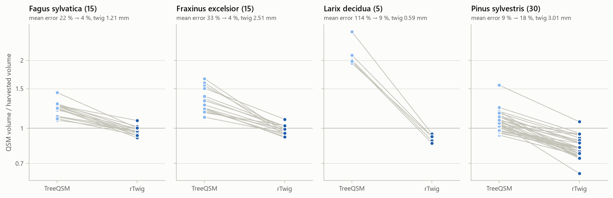
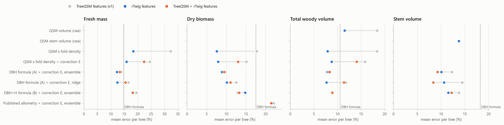

# v1.1 rTwig: full result tables

Written by `treewm evaluate-rtwig`. The question, setup and conclusions are in [README.md](README.md).
Errors are out-of-sample relMAE % (mean absolute error per tree, relative to the measured value)
unless a table says otherwise. QSM sources: TreeQSM radii as in v1; rTwig-corrected radii in place
of TreeQSM's; or the TreeQSM features plus the corrected branch volume and the size of the correction.

## 1. QSM volume against harvested volume

Median ratio QSM / harvest, and the mean absolute error of total volume, per species:

| species | n | twig_radius_mm | total_median_ratio_treeqsm | total_median_ratio_rtwig | total_relMAE_pct_treeqsm | total_relMAE_pct_rtwig | stem_median_ratio_treeqsm | stem_median_ratio_rtwig | branch_median_ratio_treeqsm | branch_median_ratio_rtwig | closer_after |
|---|---|---|---|---|---|---|---|---|---|---|---|
| Fagus sylvatica | 15 | 1.21 | 1.23 | 0.97 | 21.91 | 4.02 | 1.23 | 1.24 | 1.1 | 0.43 | 15 |
| Fraxinus excelsior | 15 | 2.51 | 1.27 | 0.98 | 33.44 | 4.19 | 1.16 | 1.08 | 1.39 | 0.69 | 15 |
| Larix decidua | 5 | 0.59 | 2.01 | 0.92 | 114.5 | 9.4 | 1.08 | 1.09 | 3.31 | 0.63 | 5 |
| Pinus sylvestris | 30 | 3.01 | 1.06 | 0.82 | 9.45 | 17.72 | 0.98 | 1.0 | 1.17 | 0.28 | 7 |
| all | 65 | nan | 1.17 | 0.93 | 25.94 | 10.8 | 1.12 | 1.08 | 1.26 | 0.42 | 42 |

## 2. leave_one_site_out, scan DBH and height

**Fresh mass** (`fresh_mass_total_kg`)

| model | no QSM | TreeQSM | rTwig | TreeQSM + rTwig |
|---|---|---|---|---|
| allometry A (DBH) | 14.8 |  |  |  |
| allometry B (DBH+H+leaf type) | 22.3 |  |  |  |
| residual D over A / ensemble | 11.4 |  |  |  |
| QSM x fold density |  | 32.3 | 18.4 |  |
| QSM x fold density + correction E |  | 24.5 | 15.9 | 22.3 |
| DBH formula (A) + correction E, ensemble |  | 13.9 | 12.2 | 13.4 |
| DBH formula (A) + correction E, ridge |  | 16.5 | 12.5 | 15.5 |
| DBH+H formula (B) + correction E, ensemble |  | 19.5 | 17.9 | 18.2 |

90 % interval coverage, fresh mass:

| model | no QSM | TreeQSM | rTwig | TreeQSM + rTwig |
|---|---|---|---|---|
| allometry A (DBH) | 0.82 |  |  |  |
| allometry B (DBH+H+leaf type) | 0.83 |  |  |  |
| residual D over A / ensemble | 0.94 |  |  |  |
| QSM x fold density |  | 0.92 | 0.74 |  |
| QSM x fold density + correction E |  | 0.94 | 0.91 | 0.94 |
| DBH formula (A) + correction E, ensemble |  | 0.88 | 0.92 | 0.91 |
| DBH formula (A) + correction E, ridge |  | 0.88 | 0.94 | 0.89 |
| DBH+H formula (B) + correction E, ensemble |  | 0.89 | 0.85 | 0.89 |

**Dry biomass** (`agb_dry_kg`)

| model | no QSM | TreeQSM | rTwig | TreeQSM + rTwig |
|---|---|---|---|---|
| allometry A (DBH) | 17.5 |  |  |  |
| allometry B (DBH+H+leaf type) | 14.8 |  |  |  |
| residual D over A / ensemble | 11.1 |  |  |  |
| QSM x fold density |  | 17.8 | 7.6 |  |
| QSM x fold density + correction E |  | 15.1 | 7.9 | 13.0 |
| DBH formula (A) + correction E, ensemble |  | 9.8 | 8.9 | 9.4 |
| DBH formula (A) + correction E, ridge |  | 12.5 | 10.1 | 11.0 |
| DBH+H formula (B) + correction E, ensemble |  | 12.8 | 14.8 | 13.3 |
| Published allometry + correction E, ensemble |  | 22.1 | 21.6 | 21.4 |

90 % interval coverage, dry biomass:

| model | no QSM | TreeQSM | rTwig | TreeQSM + rTwig |
|---|---|---|---|---|
| allometry A (DBH) | 0.92 |  |  |  |
| allometry B (DBH+H+leaf type) | 0.91 |  |  |  |
| residual D over A / ensemble | 0.95 |  |  |  |
| QSM x fold density |  | 0.92 | 0.89 |  |
| QSM x fold density + correction E |  | 0.92 | 0.91 | 0.92 |
| DBH formula (A) + correction E, ensemble |  | 0.94 | 0.95 | 0.95 |
| DBH formula (A) + correction E, ridge |  | 0.92 | 0.97 | 0.91 |
| DBH+H formula (B) + correction E, ensemble |  | 0.94 | 0.92 | 0.95 |
| Published allometry + correction E, ensemble |  | 0.94 | 0.94 | 0.94 |

**Total woody volume** (`volume_total_m3`)

| model | no QSM | TreeQSM | rTwig | TreeQSM + rTwig |
|---|---|---|---|---|
| allometry A (DBH) | 10.6 |  |  |  |
| allometry B (DBH+H+leaf type) | 13.0 |  |  |  |
| residual D over A / ensemble | 8.3 |  |  |  |
| QSM volume (raw) |  | 18.4 | 11.5 |  |
| QSM x fold density |  | 18.4 | 7.9 |  |
| QSM x fold density + correction E |  | 15.8 | 8.8 | 14.1 |
| DBH formula (A) + correction E, ensemble |  | 7.7 | 8.1 | 8.3 |
| DBH formula (A) + correction E, ridge |  | 11.8 | 7.7 | 11.4 |
| DBH+H formula (B) + correction E, ensemble |  | 9.0 | 9.0 | 8.9 |

90 % interval coverage, total woody volume:

| model | no QSM | TreeQSM | rTwig | TreeQSM + rTwig |
|---|---|---|---|---|
| allometry A (DBH) | 0.91 |  |  |  |
| allometry B (DBH+H+leaf type) | 0.85 |  |  |  |
| residual D over A / ensemble | 0.91 |  |  |  |
| QSM volume (raw) |  | 0.92 | 0.77 |  |
| QSM x fold density |  | 0.92 | 0.88 |  |
| QSM x fold density + correction E |  | 0.92 | 0.89 | 0.92 |
| DBH formula (A) + correction E, ensemble |  | 0.91 | 0.91 | 0.91 |
| DBH formula (A) + correction E, ridge |  | 0.94 | 0.92 | 0.94 |
| DBH+H formula (B) + correction E, ensemble |  | 0.94 | 0.89 | 0.89 |

**Stem volume** (`volume_stem_m3`)

| model | no QSM | TreeQSM | rTwig | TreeQSM + rTwig |
|---|---|---|---|---|
| allometry A (DBH) | 18.3 |  |  |  |
| allometry B (DBH+H+leaf type) | 17.7 |  |  |  |
| residual D over A / ensemble | 11.8 |  |  |  |
| QSM stem volume (raw) |  | 13.9 | 13.7 |  |
| DBH formula (A) + correction E, ensemble |  | 12.3 | 10.1 | 9.3 |
| DBH formula (A) + correction E, ridge |  | 14.4 | 10.6 | 8.4 |
| DBH+H formula (B) + correction E, ensemble |  | 13.7 | 11.5 | 12.2 |

90 % interval coverage, stem volume:

| model | no QSM | TreeQSM | rTwig | TreeQSM + rTwig |
|---|---|---|---|---|
| allometry A (DBH) | 0.88 |  |  |  |
| allometry B (DBH+H+leaf type) | 0.89 |  |  |  |
| residual D over A / ensemble | 0.94 |  |  |  |
| QSM stem volume (raw) |  | 0.88 | 0.91 |  |
| DBH formula (A) + correction E, ensemble |  | 0.92 | 0.91 | 0.94 |
| DBH formula (A) + correction E, ridge |  | 0.94 | 0.92 | 0.95 |
| DBH+H formula (B) + correction E, ensemble |  | 0.89 | 0.89 | 0.89 |

## 3. leave_one_site_out, inventory DBH and height

**Fresh mass** (`fresh_mass_total_kg`)

| model | no QSM | TreeQSM | rTwig | TreeQSM + rTwig |
|---|---|---|---|---|
| allometry A (DBH) | 16.4 |  |  |  |
| allometry B (DBH+H+leaf type) | 23.0 |  |  |  |
| residual D over A / ensemble | 15.4 |  |  |  |
| QSM x fold density |  | 32.3 | 18.4 |  |
| QSM x fold density + correction E |  | 27.2 | 17.0 | 25.1 |
| DBH formula (A) + correction E, ensemble |  | 15.0 | 15.3 | 14.9 |
| DBH formula (A) + correction E, ridge |  | 16.0 | 17.1 | 16.7 |
| DBH+H formula (B) + correction E, ensemble |  | 20.5 | 21.8 | 20.0 |

90 % interval coverage, fresh mass:

| model | no QSM | TreeQSM | rTwig | TreeQSM + rTwig |
|---|---|---|---|---|
| allometry A (DBH) | 0.80 |  |  |  |
| allometry B (DBH+H+leaf type) | 0.77 |  |  |  |
| residual D over A / ensemble | 0.83 |  |  |  |
| QSM x fold density |  | 0.92 | 0.74 |  |
| QSM x fold density + correction E |  | 0.94 | 0.88 | 0.94 |
| DBH formula (A) + correction E, ensemble |  | 0.83 | 0.85 | 0.83 |
| DBH formula (A) + correction E, ridge |  | 0.82 | 0.91 | 0.78 |
| DBH+H formula (B) + correction E, ensemble |  | 0.78 | 0.78 | 0.82 |

**Dry biomass** (`agb_dry_kg`)

| model | no QSM | TreeQSM | rTwig | TreeQSM + rTwig |
|---|---|---|---|---|
| allometry A (DBH) | 20.0 |  |  |  |
| allometry B (DBH+H+leaf type) | 12.5 |  |  |  |
| residual D over A / ensemble | 10.1 |  |  |  |
| QSM x fold density |  | 17.8 | 7.6 |  |
| QSM x fold density + correction E |  | 14.0 | 7.7 | 12.1 |
| DBH formula (A) + correction E, ensemble |  | 10.3 | 8.8 | 10.1 |
| DBH formula (A) + correction E, ridge |  | 14.9 | 9.6 | 11.8 |
| DBH+H formula (B) + correction E, ensemble |  | 11.1 | 12.0 | 11.7 |
| Published allometry + correction E, ensemble |  | 20.9 | 20.3 | 21.3 |

90 % interval coverage, dry biomass:

| model | no QSM | TreeQSM | rTwig | TreeQSM + rTwig |
|---|---|---|---|---|
| allometry A (DBH) | 0.88 |  |  |  |
| allometry B (DBH+H+leaf type) | 0.95 |  |  |  |
| residual D over A / ensemble | 0.95 |  |  |  |
| QSM x fold density |  | 0.92 | 0.89 |  |
| QSM x fold density + correction E |  | 0.92 | 0.91 | 0.92 |
| DBH formula (A) + correction E, ensemble |  | 0.98 | 0.98 | 0.98 |
| DBH formula (A) + correction E, ridge |  | 0.92 | 0.97 | 0.97 |
| DBH+H formula (B) + correction E, ensemble |  | 0.97 | 0.92 | 0.97 |
| Published allometry + correction E, ensemble |  | 0.94 | 0.94 | 0.94 |

**Total woody volume** (`volume_total_m3`)

| model | no QSM | TreeQSM | rTwig | TreeQSM + rTwig |
|---|---|---|---|---|
| allometry A (DBH) | 10.9 |  |  |  |
| allometry B (DBH+H+leaf type) | 12.0 |  |  |  |
| residual D over A / ensemble | 9.2 |  |  |  |
| QSM volume (raw) |  | 18.4 | 11.5 |  |
| QSM x fold density |  | 18.4 | 7.9 |  |
| QSM x fold density + correction E |  | 18.9 | 8.9 | 15.4 |
| DBH formula (A) + correction E, ensemble |  | 8.6 | 8.1 | 8.6 |
| DBH formula (A) + correction E, ridge |  | 11.8 | 9.0 | 14.5 |
| DBH+H formula (B) + correction E, ensemble |  | 9.5 | 9.6 | 9.5 |

90 % interval coverage, total woody volume:

| model | no QSM | TreeQSM | rTwig | TreeQSM + rTwig |
|---|---|---|---|---|
| allometry A (DBH) | 0.91 |  |  |  |
| allometry B (DBH+H+leaf type) | 0.92 |  |  |  |
| residual D over A / ensemble | 0.91 |  |  |  |
| QSM volume (raw) |  | 0.92 | 0.77 |  |
| QSM x fold density |  | 0.92 | 0.88 |  |
| QSM x fold density + correction E |  | 0.92 | 0.91 | 0.92 |
| DBH formula (A) + correction E, ensemble |  | 0.94 | 0.86 | 0.86 |
| DBH formula (A) + correction E, ridge |  | 0.91 | 0.86 | 0.92 |
| DBH+H formula (B) + correction E, ensemble |  | 0.92 | 0.89 | 0.89 |

**Stem volume** (`volume_stem_m3`)

| model | no QSM | TreeQSM | rTwig | TreeQSM + rTwig |
|---|---|---|---|---|
| allometry A (DBH) | 15.8 |  |  |  |
| allometry B (DBH+H+leaf type) | 16.4 |  |  |  |
| residual D over A / ensemble | 12.8 |  |  |  |
| QSM stem volume (raw) |  | 13.9 | 13.7 |  |
| DBH formula (A) + correction E, ensemble |  | 13.0 | 11.1 | 10.4 |
| DBH formula (A) + correction E, ridge |  | 15.2 | 11.4 | 8.8 |
| DBH+H formula (B) + correction E, ensemble |  | 14.3 | 12.8 | 12.9 |

90 % interval coverage, stem volume:

| model | no QSM | TreeQSM | rTwig | TreeQSM + rTwig |
|---|---|---|---|---|
| allometry A (DBH) | 0.89 |  |  |  |
| allometry B (DBH+H+leaf type) | 0.94 |  |  |  |
| residual D over A / ensemble | 0.91 |  |  |  |
| QSM stem volume (raw) |  | 0.88 | 0.91 |  |
| DBH formula (A) + correction E, ensemble |  | 0.91 | 0.89 | 0.91 |
| DBH formula (A) + correction E, ridge |  | 0.86 | 0.89 | 0.94 |
| DBH+H formula (B) + correction E, ensemble |  | 0.84 | 0.91 | 0.88 |

## 4. within_site_5fold, scan DBH and height

**Fresh mass** (`fresh_mass_total_kg`)

| model | no QSM | TreeQSM | rTwig | TreeQSM + rTwig |
|---|---|---|---|---|
| allometry A (DBH) | 13.0 |  |  |  |
| allometry B (DBH+H+leaf type) | 13.3 |  |  |  |
| residual D over A / ensemble | 10.4 |  |  |  |
| QSM x fold density |  | 19.4 | 10.3 |  |
| QSM x fold density + correction E |  | 9.4 | 7.4 | 9.1 |
| DBH formula (A) + correction E, ensemble |  | 9.8 | 9.1 | 9.6 |
| DBH formula (A) + correction E, ridge |  | 11.6 | 10.1 | 11.7 |
| DBH+H formula (B) + correction E, ensemble |  | 10.2 | 9.3 | 9.9 |

90 % interval coverage, fresh mass:

| model | no QSM | TreeQSM | rTwig | TreeQSM + rTwig |
|---|---|---|---|---|
| allometry A (DBH) | 0.91 |  |  |  |
| allometry B (DBH+H+leaf type) | 0.86 |  |  |  |
| residual D over A / ensemble | 0.94 |  |  |  |
| QSM x fold density |  | 0.91 | 0.89 |  |
| QSM x fold density + correction E |  | 0.95 | 0.92 | 0.91 |
| DBH formula (A) + correction E, ensemble |  | 0.91 | 0.94 | 0.91 |
| DBH formula (A) + correction E, ridge |  | 0.89 | 0.91 | 0.91 |
| DBH+H formula (B) + correction E, ensemble |  | 0.91 | 0.94 | 0.91 |

**Dry biomass** (`agb_dry_kg`)

| model | no QSM | TreeQSM | rTwig | TreeQSM + rTwig |
|---|---|---|---|---|
| allometry A (DBH) | 14.8 |  |  |  |
| allometry B (DBH+H+leaf type) | 11.9 |  |  |  |
| residual D over A / ensemble | 10.3 |  |  |  |
| QSM x fold density |  | 14.5 | 6.7 |  |
| QSM x fold density + correction E |  | 9.6 | 6.8 | 8.7 |
| DBH formula (A) + correction E, ensemble |  | 9.9 | 8.8 | 9.5 |
| DBH formula (A) + correction E, ridge |  | 11.0 | 9.2 | 9.8 |
| DBH+H formula (B) + correction E, ensemble |  | 9.9 | 8.7 | 9.6 |
| Published allometry + correction E, ensemble |  | 14.8 | 15.1 | 14.9 |

90 % interval coverage, dry biomass:

| model | no QSM | TreeQSM | rTwig | TreeQSM + rTwig |
|---|---|---|---|---|
| allometry A (DBH) | 0.91 |  |  |  |
| allometry B (DBH+H+leaf type) | 0.92 |  |  |  |
| residual D over A / ensemble | 0.92 |  |  |  |
| QSM x fold density |  | 0.92 | 0.92 |  |
| QSM x fold density + correction E |  | 0.91 | 0.92 | 0.91 |
| DBH formula (A) + correction E, ensemble |  | 0.92 | 0.89 | 0.92 |
| DBH formula (A) + correction E, ridge |  | 0.89 | 0.95 | 0.92 |
| DBH+H formula (B) + correction E, ensemble |  | 0.91 | 0.92 | 0.91 |
| Published allometry + correction E, ensemble |  | 0.88 | 0.89 | 0.89 |

**Total woody volume** (`volume_total_m3`)

| model | no QSM | TreeQSM | rTwig | TreeQSM + rTwig |
|---|---|---|---|---|
| allometry A (DBH) | 10.7 |  |  |  |
| allometry B (DBH+H+leaf type) | 10.5 |  |  |  |
| residual D over A / ensemble | 8.3 |  |  |  |
| QSM volume (raw) |  | 16.1 | 9.5 |  |
| QSM x fold density |  | 15.1 | 6.4 |  |
| QSM x fold density + correction E |  | 6.5 | 5.8 | 5.8 |
| DBH formula (A) + correction E, ensemble |  | 6.8 | 6.7 | 6.7 |
| DBH formula (A) + correction E, ridge |  | 8.2 | 7.2 | 8.1 |
| DBH+H formula (B) + correction E, ensemble |  | 6.9 | 6.5 | 6.9 |

90 % interval coverage, total woody volume:

| model | no QSM | TreeQSM | rTwig | TreeQSM + rTwig |
|---|---|---|---|---|
| allometry A (DBH) | 0.91 |  |  |  |
| allometry B (DBH+H+leaf type) | 0.88 |  |  |  |
| residual D over A / ensemble | 0.91 |  |  |  |
| QSM volume (raw) |  | 0.91 | 0.91 |  |
| QSM x fold density |  | 0.91 | 0.88 |  |
| QSM x fold density + correction E |  | 0.89 | 0.92 | 0.92 |
| DBH formula (A) + correction E, ensemble |  | 0.92 | 0.94 | 0.92 |
| DBH formula (A) + correction E, ridge |  | 0.91 | 0.91 | 0.91 |
| DBH+H formula (B) + correction E, ensemble |  | 0.95 | 0.94 | 0.95 |

**Stem volume** (`volume_stem_m3`)

| model | no QSM | TreeQSM | rTwig | TreeQSM + rTwig |
|---|---|---|---|---|
| allometry A (DBH) | 15.3 |  |  |  |
| allometry B (DBH+H+leaf type) | 12.0 |  |  |  |
| residual D over A / ensemble | 10.0 |  |  |  |
| QSM stem volume (raw) |  | 11.9 | 11.8 |  |
| DBH formula (A) + correction E, ensemble |  | 9.8 | 9.3 | 9.1 |
| DBH formula (A) + correction E, ridge |  | 10.1 | 9.1 | 7.7 |
| DBH+H formula (B) + correction E, ensemble |  | 10.1 | 9.5 | 9.0 |

90 % interval coverage, stem volume:

| model | no QSM | TreeQSM | rTwig | TreeQSM + rTwig |
|---|---|---|---|---|
| allometry A (DBH) | 0.91 |  |  |  |
| allometry B (DBH+H+leaf type) | 0.91 |  |  |  |
| residual D over A / ensemble | 0.94 |  |  |  |
| QSM stem volume (raw) |  | 0.91 | 0.91 |  |
| DBH formula (A) + correction E, ensemble |  | 0.92 | 0.92 | 0.92 |
| DBH formula (A) + correction E, ridge |  | 0.95 | 0.94 | 0.97 |
| DBH+H formula (B) + correction E, ensemble |  | 0.91 | 0.91 | 0.92 |

## 5. within_site_5fold, inventory DBH and height

**Fresh mass** (`fresh_mass_total_kg`)

| model | no QSM | TreeQSM | rTwig | TreeQSM + rTwig |
|---|---|---|---|---|
| allometry A (DBH) | 14.2 |  |  |  |
| allometry B (DBH+H+leaf type) | 13.3 |  |  |  |
| residual D over A / ensemble | 11.4 |  |  |  |
| QSM x fold density |  | 19.4 | 10.3 |  |
| QSM x fold density + correction E |  | 10.0 | 7.4 | 8.9 |
| DBH formula (A) + correction E, ensemble |  | 10.9 | 9.5 | 10.9 |
| DBH formula (A) + correction E, ridge |  | 12.5 | 10.3 | 12.6 |
| DBH+H formula (B) + correction E, ensemble |  | 11.9 | 10.7 | 11.9 |

90 % interval coverage, fresh mass:

| model | no QSM | TreeQSM | rTwig | TreeQSM + rTwig |
|---|---|---|---|---|
| allometry A (DBH) | 0.89 |  |  |  |
| allometry B (DBH+H+leaf type) | 0.89 |  |  |  |
| residual D over A / ensemble | 0.89 |  |  |  |
| QSM x fold density |  | 0.91 | 0.89 |  |
| QSM x fold density + correction E |  | 0.94 | 0.97 | 0.92 |
| DBH formula (A) + correction E, ensemble |  | 0.89 | 0.88 | 0.89 |
| DBH formula (A) + correction E, ridge |  | 0.91 | 0.89 | 0.91 |
| DBH+H formula (B) + correction E, ensemble |  | 0.86 | 0.89 | 0.86 |

**Dry biomass** (`agb_dry_kg`)

| model | no QSM | TreeQSM | rTwig | TreeQSM + rTwig |
|---|---|---|---|---|
| allometry A (DBH) | 15.7 |  |  |  |
| allometry B (DBH+H+leaf type) | 10.7 |  |  |  |
| residual D over A / ensemble | 9.8 |  |  |  |
| QSM x fold density |  | 14.5 | 6.7 |  |
| QSM x fold density + correction E |  | 9.0 | 6.9 | 8.1 |
| DBH formula (A) + correction E, ensemble |  | 9.6 | 8.4 | 9.7 |
| DBH formula (A) + correction E, ridge |  | 10.5 | 9.2 | 10.9 |
| DBH+H formula (B) + correction E, ensemble |  | 9.1 | 8.8 | 9.1 |
| Published allometry + correction E, ensemble |  | 14.1 | 13.3 | 14.4 |

90 % interval coverage, dry biomass:

| model | no QSM | TreeQSM | rTwig | TreeQSM + rTwig |
|---|---|---|---|---|
| allometry A (DBH) | 0.92 |  |  |  |
| allometry B (DBH+H+leaf type) | 0.89 |  |  |  |
| residual D over A / ensemble | 0.92 |  |  |  |
| QSM x fold density |  | 0.92 | 0.92 |  |
| QSM x fold density + correction E |  | 0.92 | 0.94 | 0.92 |
| DBH formula (A) + correction E, ensemble |  | 0.92 | 0.92 | 0.92 |
| DBH formula (A) + correction E, ridge |  | 0.94 | 0.94 | 0.92 |
| DBH+H formula (B) + correction E, ensemble |  | 0.91 | 0.91 | 0.91 |
| Published allometry + correction E, ensemble |  | 0.89 | 0.89 | 0.91 |

**Total woody volume** (`volume_total_m3`)

| model | no QSM | TreeQSM | rTwig | TreeQSM + rTwig |
|---|---|---|---|---|
| allometry A (DBH) | 10.7 |  |  |  |
| allometry B (DBH+H+leaf type) | 10.2 |  |  |  |
| residual D over A / ensemble | 9.2 |  |  |  |
| QSM volume (raw) |  | 16.1 | 9.5 |  |
| QSM x fold density |  | 15.1 | 6.4 |  |
| QSM x fold density + correction E |  | 6.7 | 5.8 | 6.3 |
| DBH formula (A) + correction E, ensemble |  | 8.4 | 8.1 | 8.5 |
| DBH formula (A) + correction E, ridge |  | 9.4 | 8.8 | 9.6 |
| DBH+H formula (B) + correction E, ensemble |  | 8.3 | 8.0 | 8.4 |

90 % interval coverage, total woody volume:

| model | no QSM | TreeQSM | rTwig | TreeQSM + rTwig |
|---|---|---|---|---|
| allometry A (DBH) | 0.92 |  |  |  |
| allometry B (DBH+H+leaf type) | 0.92 |  |  |  |
| residual D over A / ensemble | 0.89 |  |  |  |
| QSM volume (raw) |  | 0.91 | 0.91 |  |
| QSM x fold density |  | 0.91 | 0.88 |  |
| QSM x fold density + correction E |  | 0.92 | 0.91 | 0.92 |
| DBH formula (A) + correction E, ensemble |  | 0.91 | 0.91 | 0.89 |
| DBH formula (A) + correction E, ridge |  | 0.92 | 0.86 | 0.92 |
| DBH+H formula (B) + correction E, ensemble |  | 0.91 | 0.94 | 0.91 |

**Stem volume** (`volume_stem_m3`)

| model | no QSM | TreeQSM | rTwig | TreeQSM + rTwig |
|---|---|---|---|---|
| allometry A (DBH) | 14.4 |  |  |  |
| allometry B (DBH+H+leaf type) | 11.8 |  |  |  |
| residual D over A / ensemble | 9.8 |  |  |  |
| QSM stem volume (raw) |  | 11.9 | 11.8 |  |
| DBH formula (A) + correction E, ensemble |  | 9.7 | 9.0 | 8.6 |
| DBH formula (A) + correction E, ridge |  | 9.8 | 8.9 | 7.5 |
| DBH+H formula (B) + correction E, ensemble |  | 9.9 | 9.5 | 9.2 |

90 % interval coverage, stem volume:

| model | no QSM | TreeQSM | rTwig | TreeQSM + rTwig |
|---|---|---|---|---|
| allometry A (DBH) | 0.92 |  |  |  |
| allometry B (DBH+H+leaf type) | 0.94 |  |  |  |
| residual D over A / ensemble | 0.94 |  |  |  |
| QSM stem volume (raw) |  | 0.91 | 0.91 |  |
| DBH formula (A) + correction E, ensemble |  | 0.89 | 0.91 | 0.91 |
| DBH formula (A) + correction E, ridge |  | 0.95 | 0.94 | 0.97 |
| DBH+H formula (B) + correction E, ensemble |  | 0.92 | 0.92 | 0.94 |

## 6. Errors by species, leave_one_site_out, scan inputs

| target | qsm_source | model | species_latin | n | relMAE_pct | bias_pct | coverage90 |
|---|---|---|---|---|---|---|---|
| fresh_mass_total_kg | none | allometry A (DBH) | Fagus sylvatica | 15 | 16.3 | -14.8 | 0.53 |
| fresh_mass_total_kg | none | allometry A (DBH) | Fraxinus excelsior | 15 | 22.8 | 17.2 | 0.73 |
| fresh_mass_total_kg | none | allometry A (DBH) | Larix decidua | 5 | 4.6 | -3.3 | 1.0 |
| fresh_mass_total_kg | none | allometry A (DBH) | Pinus sylvestris | 30 | 11.7 | 6.1 | 0.97 |
| fresh_mass_total_kg | treeqsm | QSM x fold density | Fagus sylvatica | 15 | 23.5 | -23.5 | 1.0 |
| fresh_mass_total_kg | treeqsm | QSM x fold density | Fraxinus excelsior | 15 | 51.9 | 51.9 | 1.0 |
| fresh_mass_total_kg | treeqsm | QSM x fold density | Larix decidua | 5 | 108.2 | 108.2 | 0.0 |
| fresh_mass_total_kg | treeqsm | QSM x fold density | Pinus sylvestris | 30 | 14.3 | 9.4 | 1.0 |
| fresh_mass_total_kg | rtwig | QSM x fold density | Fagus sylvatica | 15 | 23.3 | -23.3 | 0.67 |
| fresh_mass_total_kg | rtwig | QSM x fold density | Fraxinus excelsior | 15 | 26.9 | 26.9 | 0.27 |
| fresh_mass_total_kg | rtwig | QSM x fold density | Larix decidua | 5 | 13.5 | 13.5 | 1.0 |
| fresh_mass_total_kg | rtwig | QSM x fold density | Pinus sylvestris | 30 | 12.5 | 2.6 | 0.97 |
| fresh_mass_total_kg | treeqsm | residual E over A / ensemble | Fagus sylvatica | 15 | 12.6 | -11.5 | 0.87 |
| fresh_mass_total_kg | treeqsm | residual E over A / ensemble | Fraxinus excelsior | 15 | 23.8 | 22.5 | 0.73 |
| fresh_mass_total_kg | treeqsm | residual E over A / ensemble | Larix decidua | 5 | 16.1 | 13.0 | 1.0 |
| fresh_mass_total_kg | treeqsm | residual E over A / ensemble | Pinus sylvestris | 30 | 9.1 | -1.3 | 0.93 |
| fresh_mass_total_kg | rtwig | residual E over A / ensemble | Fagus sylvatica | 15 | 11.7 | -9.7 | 1.0 |
| fresh_mass_total_kg | rtwig | residual E over A / ensemble | Fraxinus excelsior | 15 | 21.9 | 20.8 | 0.8 |
| fresh_mass_total_kg | rtwig | residual E over A / ensemble | Larix decidua | 5 | 10.7 | -4.2 | 0.6 |
| fresh_mass_total_kg | rtwig | residual E over A / ensemble | Pinus sylvestris | 30 | 7.9 | -0.9 | 1.0 |
| fresh_mass_total_kg | both | residual E+rTwig over A / ensemble | Fagus sylvatica | 15 | 12.5 | -11.4 | 0.87 |
| fresh_mass_total_kg | both | residual E+rTwig over A / ensemble | Fraxinus excelsior | 15 | 23.7 | 22.5 | 0.73 |
| fresh_mass_total_kg | both | residual E+rTwig over A / ensemble | Larix decidua | 5 | 14.9 | 3.6 | 1.0 |
| fresh_mass_total_kg | both | residual E+rTwig over A / ensemble | Pinus sylvestris | 30 | 8.4 | -2.1 | 1.0 |
| agb_dry_kg | none | allometry A (DBH) | Fagus sylvatica | 15 | 15.9 | -13.8 | 0.93 |
| agb_dry_kg | none | allometry A (DBH) | Fraxinus excelsior | 15 | 16.4 | -6.8 | 0.93 |
| agb_dry_kg | none | allometry A (DBH) | Larix decidua | 5 | 4.3 | -3.5 | 1.0 |
| agb_dry_kg | none | allometry A (DBH) | Pinus sylvestris | 30 | 21.1 | 20.5 | 0.9 |
| agb_dry_kg | treeqsm | QSM x fold density | Fagus sylvatica | 15 | 9.4 | 3.6 | 1.0 |
| agb_dry_kg | treeqsm | QSM x fold density | Fraxinus excelsior | 15 | 20.6 | 20.4 | 1.0 |
| agb_dry_kg | treeqsm | QSM x fold density | Larix decidua | 5 | 80.4 | 80.4 | 0.0 |
| agb_dry_kg | treeqsm | QSM x fold density | Pinus sylvestris | 30 | 10.2 | 4.5 | 1.0 |
| agb_dry_kg | rtwig | QSM x fold density | Fagus sylvatica | 15 | 7.2 | 4.5 | 1.0 |
| agb_dry_kg | rtwig | QSM x fold density | Fraxinus excelsior | 15 | 5.0 | 1.1 | 1.0 |
| agb_dry_kg | rtwig | QSM x fold density | Larix decidua | 5 | 3.3 | -0.9 | 1.0 |
| agb_dry_kg | rtwig | QSM x fold density | Pinus sylvestris | 30 | 9.7 | 1.0 | 0.77 |
| agb_dry_kg | treeqsm | residual E over A / ensemble | Fagus sylvatica | 15 | 8.4 | 3.5 | 1.0 |
| agb_dry_kg | treeqsm | residual E over A / ensemble | Fraxinus excelsior | 15 | 10.8 | 2.1 | 0.93 |
| agb_dry_kg | treeqsm | residual E over A / ensemble | Larix decidua | 5 | 13.9 | 12.9 | 0.8 |
| agb_dry_kg | treeqsm | residual E over A / ensemble | Pinus sylvestris | 30 | 9.2 | 1.6 | 0.93 |
| agb_dry_kg | rtwig | residual E over A / ensemble | Fagus sylvatica | 15 | 9.4 | 6.5 | 1.0 |
| agb_dry_kg | rtwig | residual E over A / ensemble | Fraxinus excelsior | 15 | 10.5 | 2.3 | 0.93 |
| agb_dry_kg | rtwig | residual E over A / ensemble | Larix decidua | 5 | 7.5 | -6.8 | 0.8 |
| agb_dry_kg | rtwig | residual E over A / ensemble | Pinus sylvestris | 30 | 8.1 | 1.3 | 0.97 |
| agb_dry_kg | both | residual E+rTwig over A / ensemble | Fagus sylvatica | 15 | 8.5 | 4.2 | 1.0 |
| agb_dry_kg | both | residual E+rTwig over A / ensemble | Fraxinus excelsior | 15 | 10.6 | 2.7 | 0.93 |
| agb_dry_kg | both | residual E+rTwig over A / ensemble | Larix decidua | 5 | 10.3 | 7.1 | 1.0 |
| agb_dry_kg | both | residual E+rTwig over A / ensemble | Pinus sylvestris | 30 | 9.2 | -1.0 | 0.93 |
| volume_total_m3 | none | allometry A (DBH) | Fagus sylvatica | 15 | 10.2 | 0.4 | 1.0 |
| volume_total_m3 | none | allometry A (DBH) | Fraxinus excelsior | 15 | 17.5 | 8.2 | 0.6 |
| volume_total_m3 | none | allometry A (DBH) | Larix decidua | 5 | 7.0 | -7.0 | 1.0 |
| volume_total_m3 | none | allometry A (DBH) | Pinus sylvestris | 30 | 7.9 | 0.1 | 1.0 |
| volume_total_m3 | treeqsm | QSM x fold density | Fagus sylvatica | 15 | 6.4 | -4.5 | 1.0 |
| volume_total_m3 | treeqsm | QSM x fold density | Fraxinus excelsior | 15 | 16.6 | 16.3 | 1.0 |
| volume_total_m3 | treeqsm | QSM x fold density | Larix decidua | 5 | 101.3 | 101.3 | 0.0 |
| volume_total_m3 | treeqsm | QSM x fold density | Pinus sylvestris | 30 | 11.4 | 6.5 | 1.0 |
| volume_total_m3 | rtwig | QSM x fold density | Fagus sylvatica | 15 | 5.1 | -4.2 | 1.0 |
| volume_total_m3 | rtwig | QSM x fold density | Fraxinus excelsior | 15 | 4.4 | -2.4 | 1.0 |
| volume_total_m3 | rtwig | QSM x fold density | Larix decidua | 5 | 10.5 | 10.5 | 1.0 |
| volume_total_m3 | rtwig | QSM x fold density | Pinus sylvestris | 30 | 10.6 | 0.7 | 0.73 |
| volume_total_m3 | treeqsm | residual E over A / ensemble | Fagus sylvatica | 15 | 6.5 | 4.4 | 0.93 |
| volume_total_m3 | treeqsm | residual E over A / ensemble | Fraxinus excelsior | 15 | 9.4 | 4.7 | 0.8 |
| volume_total_m3 | treeqsm | residual E over A / ensemble | Larix decidua | 5 | 13.6 | 11.0 | 1.0 |
| volume_total_m3 | treeqsm | residual E over A / ensemble | Pinus sylvestris | 30 | 6.4 | -0.3 | 0.93 |
| volume_total_m3 | rtwig | residual E over A / ensemble | Fagus sylvatica | 15 | 7.6 | 6.9 | 0.93 |
| volume_total_m3 | rtwig | residual E over A / ensemble | Fraxinus excelsior | 15 | 10.4 | 3.7 | 0.8 |
| volume_total_m3 | rtwig | residual E over A / ensemble | Larix decidua | 5 | 7.9 | -7.2 | 0.8 |
| volume_total_m3 | rtwig | residual E over A / ensemble | Pinus sylvestris | 30 | 7.1 | -2.4 | 0.97 |
| volume_total_m3 | both | residual E+rTwig over A / ensemble | Fagus sylvatica | 15 | 6.9 | 4.7 | 0.93 |
| volume_total_m3 | both | residual E+rTwig over A / ensemble | Fraxinus excelsior | 15 | 10.0 | 5.6 | 0.87 |
| volume_total_m3 | both | residual E+rTwig over A / ensemble | Larix decidua | 5 | 13.1 | 10.8 | 1.0 |
| volume_total_m3 | both | residual E+rTwig over A / ensemble | Pinus sylvestris | 30 | 7.4 | -2.4 | 0.9 |
| volume_stem_m3 | none | allometry A (DBH) | Fagus sylvatica | 15 | 12.7 | 7.7 | 1.0 |
| volume_stem_m3 | none | allometry A (DBH) | Fraxinus excelsior | 14 | 37.0 | 36.2 | 0.57 |
| volume_stem_m3 | none | allometry A (DBH) | Larix decidua | 5 | 7.2 | 6.0 | 1.0 |
| volume_stem_m3 | none | allometry A (DBH) | Pinus sylvestris | 30 | 14.1 | -11.0 | 0.93 |
| volume_stem_m3 | treeqsm | residual E over A / ensemble | Fagus sylvatica | 15 | 10.3 | -6.9 | 1.0 |
| volume_stem_m3 | treeqsm | residual E over A / ensemble | Fraxinus excelsior | 14 | 25.0 | 22.7 | 0.71 |
| volume_stem_m3 | treeqsm | residual E over A / ensemble | Larix decidua | 5 | 11.0 | -11.0 | 0.8 |
| volume_stem_m3 | treeqsm | residual E over A / ensemble | Pinus sylvestris | 30 | 7.6 | -1.6 | 1.0 |
| volume_stem_m3 | rtwig | residual E over A / ensemble | Fagus sylvatica | 15 | 7.8 | 1.2 | 1.0 |
| volume_stem_m3 | rtwig | residual E over A / ensemble | Fraxinus excelsior | 14 | 18.7 | 16.0 | 0.71 |
| volume_stem_m3 | rtwig | residual E over A / ensemble | Larix decidua | 5 | 11.9 | -11.9 | 0.8 |
| volume_stem_m3 | rtwig | residual E over A / ensemble | Pinus sylvestris | 30 | 6.9 | -2.7 | 0.97 |
| volume_stem_m3 | both | residual E+rTwig over A / ensemble | Fagus sylvatica | 15 | 7.9 | -2.3 | 1.0 |
| volume_stem_m3 | both | residual E+rTwig over A / ensemble | Fraxinus excelsior | 14 | 17.4 | 14.3 | 0.71 |
| volume_stem_m3 | both | residual E+rTwig over A / ensemble | Larix decidua | 5 | 6.1 | -4.3 | 1.0 |
| volume_stem_m3 | both | residual E+rTwig over A / ensemble | Pinus sylvestris | 30 | 6.7 | -2.8 | 1.0 |

