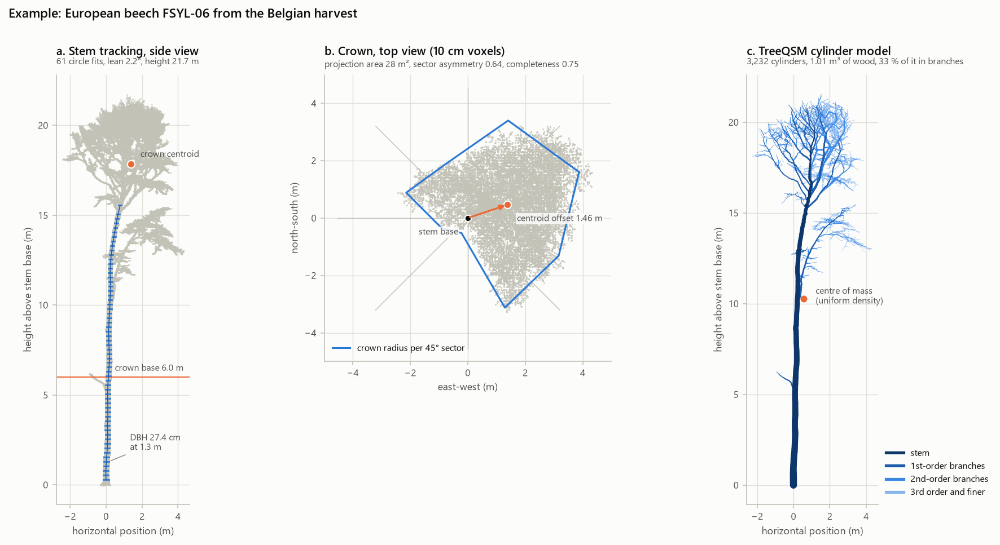
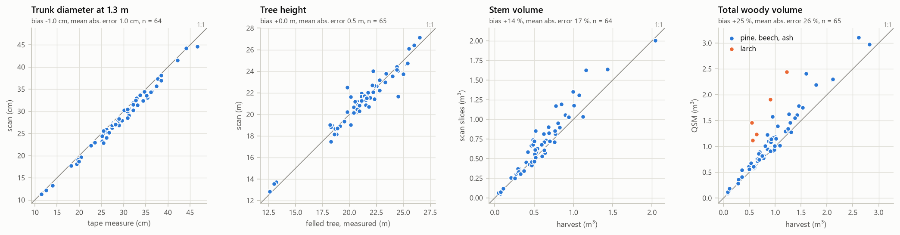
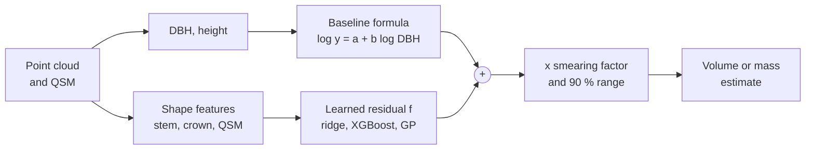
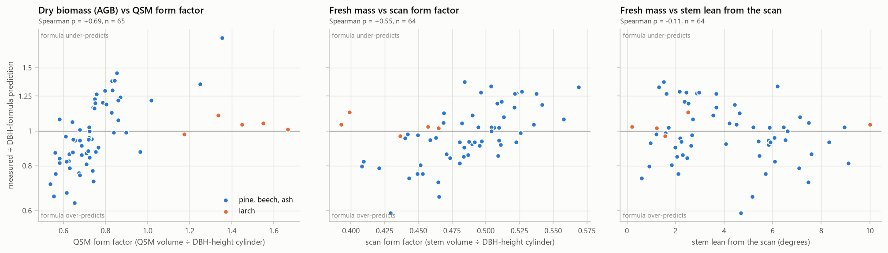
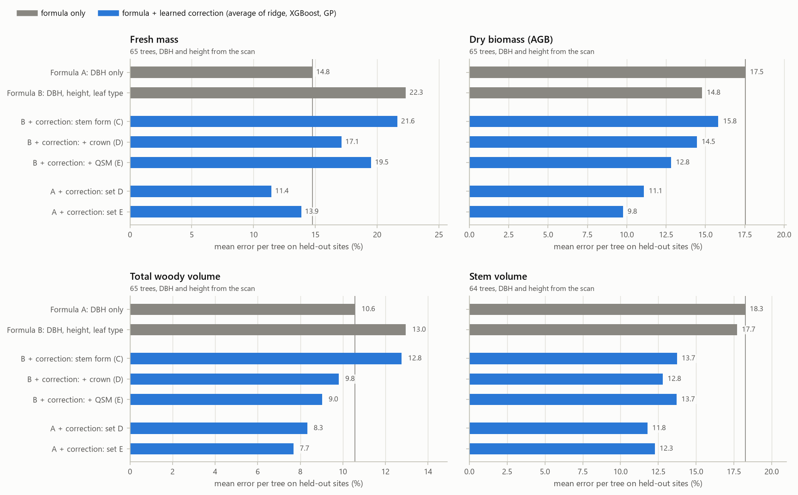
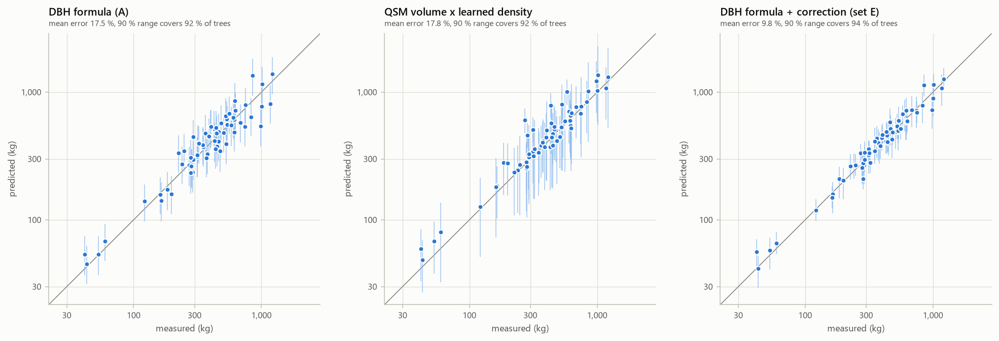
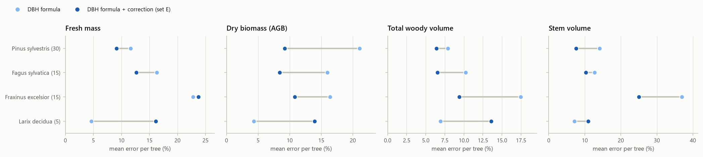
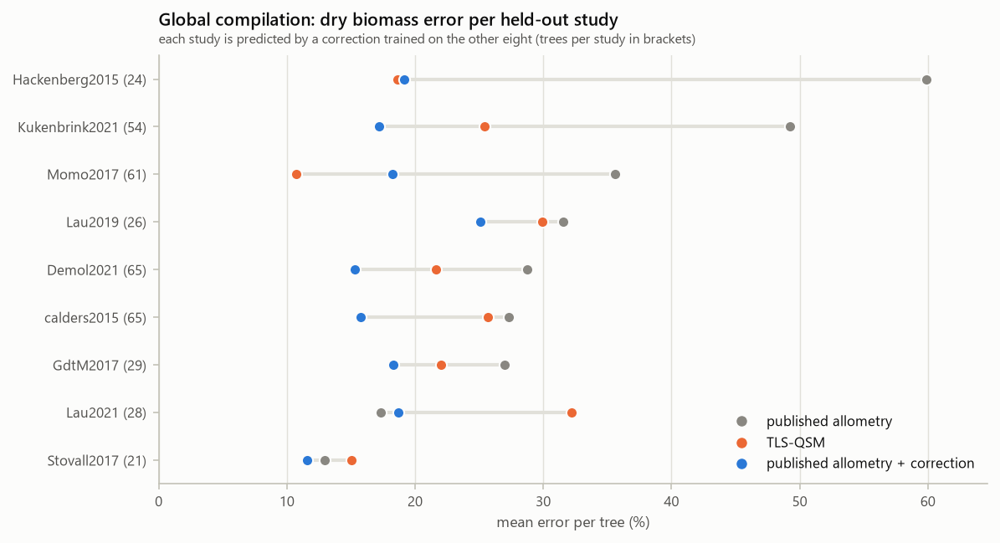
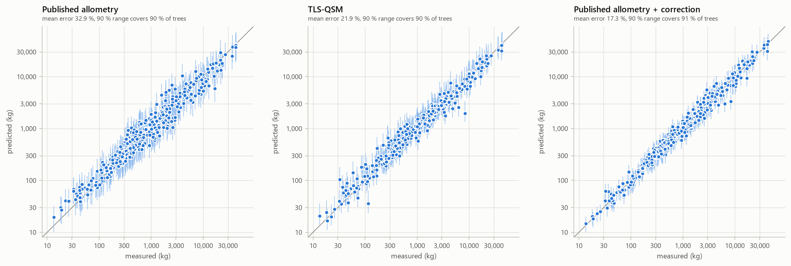

# Tree World Model v1: tree volume and biomass from laser scans

This report describes the first version of the Tree World Model. It estimates a tree's wood
volume and mass from a 3D laser scan, and it tests whether a learned correction makes the
standard forestry formula more accurate on trees the model has never seen.

The short answer is yes, with limits. Trees were scanned and then cut down and weighed. For
these trees, a correction learned from scan shape lowered the error of the standard
trunk-diameter formula on every target. It was tested on whole forest sites held out from
training. On a global compilation of 373 weighed trees from nine studies, the same idea cut the
error of published biomass equations roughly in half. The main limitation is size. The
detailed experiment rests on 65 trees of four European species, and the correction made
predictions worse for the smallest species group, larch.

All numbers in this report are out-of-sample. Every tree is predicted by a model that never
saw that tree's site, or that tree's study in the global comparison. The complete result tables
for every model are in [tables.md](tables.md), and the raw numbers are in
[metrics.csv](metrics.csv).

## Contents

1. [Summary of results](#1-summary-of-results)
2. [The problem and the approach](#2-the-problem-and-the-approach)
3. [Data](#3-data)
4. [Measuring trees from scans](#4-measuring-trees-from-scans)
5. [Models](#5-models)
6. [How the error was brought down](#6-how-the-error-was-brought-down)
7. [Results in detail](#7-results-in-detail)
8. [The deployable model](#8-the-deployable-model)
9. [Limitations](#9-limitations)
10. [Next steps](#10-next-steps)
11. [Reproducing this report](#11-reproducing-this-report)

---

## 1. Summary of results

**Belgian harvest: 65 trees, 4 species, 5 sites.** Each site is held out in turn, and DBH and
height come from the scan, not from a tape measure. Error is the mean absolute difference
between prediction and measurement, as a percentage of the measurement.

| What is predicted | Standard DBH formula | Best learned correction | Error removed | 90 % range coverage, formula then corrected |
|---|---|---|---|---|
| Fresh mass (as weighed) | 14.8 % | 11.4 % | 23 % | 0.82, then 0.94 |
| Dry biomass (AGB) | 17.5 % | 9.8 % | 44 % | 0.92, then 0.94 |
| Total woody volume | 10.6 % | 7.7 % | 27 % | 0.91, then 0.91 |
| Stem volume | 18.3 % | 11.6 % | 37 % | 0.88, then 0.92 |

**Global compilation: 373 weighed trees, 9 studies, each study held out in turn.**

| Dry biomass estimate | Error | Log RMSE |
|---|---|---|
| Published allometric equation, as reported by each study | 32.9 % | 0.37 |
| TLS cylinder model (QSM), as reported by each study | 21.9 % | 0.29 |
| Published equation plus learned correction | 17.3 % | 0.22 |

**BioDiv-3DTrees: 1,889 broadleaf trees, 27 plots.** Drone-scan crown shape lowered the log
error of a DBH and height formula from 0.40 to 0.36. The target there is a reconstructed
volume, not a weighed one.

What the experiments show:

- **The gain comes from shape the formula cannot see.** Trees with more wood per unit of trunk
  diameter than average are underestimated by the formula. The scan's form factor and branch
  volume measure exactly that.
- **Corrections built from inventory variables alone do nothing.** Re-weighting DBH, height
  and leaf type on the global compilation left the error at 31.7 %.
- **The simplest base formula transfers best.** Adding height and leaf type helped within a
  site but hurt on unseen species for fresh mass and total volume. The correction therefore sits
  on the DBH-only formula.
- **Cylinder models are a good input but a poor answer.** QSM volume overestimated harvested
  volume by 25 % on average and by about 2 times for larch. Used directly it was worse than the
  formula, but as a correction input it carried the most information.
- **The uncertainty ranges hold on unseen sites.** The corrected models' 90 % ranges contained
  91 to 94 % of held-out trees. The plain formula's range held only 82 % for fresh mass.
- **It did not help every species.** Larch, with 5 trees, got worse on all four targets. Ash
  fresh mass did not improve, because the scan sees shape but not water content.

---

## 2. The problem and the approach

### Why estimate tree mass from scans

Forest carbon, timber volume and the physical behaviour of a tree all depend on how much wood
it has and where that wood sits. The only exact way to measure tree mass is to cut the tree
down and weigh it. That is slow, destructive and rarely done. Foresters instead use
**allometric equations**: power laws fitted to a few hundred felled trees. They predict mass
from trunk diameter at 1.3 m, called **DBH**, and sometimes from height.

Allometric equations are cheap but blunt. Two trees with the same DBH can differ a lot in
height, crown size, stem taper and wood density. The equation gives both the same answer. Its
error for a single tree is often 20 to 40 %, and it can be biased for a whole stand when the
local trees differ from the ones the equation was fitted on.

A **terrestrial laser scanner (TLS)** records millions of 3D points on a tree. From the points
we can measure the trunk, the crown and the branches directly. Software such as TreeQSM can fit
a **quantitative structure model (QSM)**, a set of cylinders that reconstructs the woody
skeleton. Multiplying QSM volume by wood density gives a mass estimate without any equation.
In practice QSMs have their own errors. Fine twigs are hard to reconstruct, occluded branches
are missed, and wood density still has to be assumed.

### The question v1 tests

The design document for this project proposes a hybrid. Keep the allometric equation as a
physically sensible baseline, measure tree shape from the scan, and let a machine-learning
model learn only the **residual**: how far the equation is off for this particular tree, given
its shape.

v1 tests whether that correction actually improves on the equation for trees from places it
was not trained on. Doing well on more trees from the same stand is the easy case. A tool that
will be used in new forests has to do well on trees from new places. Every main result here is
therefore measured with whole sites, or whole studies, held out.

### Terms used in this report

| Term | Meaning |
|---|---|
| DBH | Trunk diameter at breast height, 1.3 m above the ground |
| Allometry, allometric equation | A fitted formula that predicts mass or volume from DBH, and sometimes height |
| AGB | Above-ground biomass: dry mass of stem, branches and twigs, without roots or leaves |
| Fresh mass | Mass as weighed at felling, including the water in the wood |
| TLS | Terrestrial laser scanning, from tripods on the ground |
| ULS | Laser scanning from a drone (unmanned aerial vehicle), which sees crowns from above |
| QSM | Quantitative structure model: a cylinder reconstruction of the woody tree |
| Form factor | Volume divided by the volume of a cylinder with the tree's DBH and height |
| Residual, correction | The log-ratio between the measured value and the formula's prediction |
| Held-out site | A site whose trees are kept out of training and used only for testing |
| Coverage | The share of trees whose measured value falls inside the predicted 90 % range |

---

## 3. Data

Three public datasets were used, all under the CC BY 4.0 licence. Each answers a different
question.

| Dataset | Trees used | Ground truth | Role in v1 |
|---|---|---|---|
| Belgian destructive harvest (Demol et al. 2021) | 65 | Weighed fresh mass, measured densities | Main experiment: does the correction work on unseen sites? |
| Global TLS and harvest compilation (Demol et al. 2025, CEDA archive) | 373 | Dry biomass from harvesting | External check across continents, scanners and QSM software |
| BioDiv-3DTrees (Griese et al. 2025) | 1,889 | None physical; QSM volume only | Scale check: does drone crown shape carry volume information? |

### 3.1 Belgian destructive harvest

Source: [Zenodo record 4557401](https://zenodo.org/records/4557401).

Sixty-six trees on five sites in Belgium were scanned with a terrestrial laser scanner, then
felled. Every part of each tree was weighed fresh, separately for stem and crown. Wood discs
were cut to measure wood density and dry-matter content. One ash tree, FEXC-12, was scanned
but has no harvest record. It is kept in the data but never used for training or scoring,
which leaves 65 labelled trees.

| Site | Species | Trees | DBH (cm) | Height (m) | Fresh mass (kg) | Fresh wood density (kg/m³) | Basic density (kg/m³) |
|---|---|---|---|---|---|---|---|
| PSYLA | Scots pine, *Pinus sylvestris* | 15 | 25.1 – 38.5 | 18.6 – 24.5 | 492 – 1,293 | 886 | 470 |
| PSYLB | Scots pine, *Pinus sylvestris* | 15 | 14.0 – 46.6 | 18.3 – 26.5 | 93 – 2,428 | 866 | 455 |
| FSYL | European beech, *Fagus sylvatica* | 15 | 25.5 – 38.5 | 18.8 – 24.5 | 659 – 2,103 | 1,032 | 559 |
| FEXC | European ash, *Fraxinus excelsior* | 15 | 11.5 – 39.8 | 12.6 – 22.5 | 62 – 1,444 | 835 | 549 |
| LXDC | European larch, *Larix decidua* | 5 | 23.6 – 32.1 | 19.8 – 21.5 | 482 – 1,050 | 865 | 500 |

Densities are site means. Fresh density includes water and basic density does not. Note that
ash and beech have almost the same basic density but very different fresh density. That
difference comes back in the results.

**What was measured, and how the targets are defined.**

- *Fresh mass* (total, stem and crown) was weighed directly. Crown mass is a quarter of the
  total for pine and about a third or more for the broadleaves and larch.
- *Dry biomass (AGB)* is the harvested dry mass reported for the same trees in the global
  compilation below. The data owners derived it from fresh mass and measured dry-matter content.
- *Total and stem volume* in the harvest file equal fresh mass divided by the measured fresh
  wood density. They are derived quantities, not water-displacement measurements. The ingest
  step checks this relationship for every tree.
- *DBH* was taped on the standing tree and *height* was measured on the felled tree.

**Scans.** Pine, beech and ash were scanned with a RIEGL VZ-1000 and larch with a RIEGL VZ-400.
Beech and ash were leafless and larch had dropped its needles, while pine kept its needles. The
data owners segmented each tree into its own point cloud, with a median of about 300,000
points per tree and a range of 81,000 to 1.1 million. They also published an optimal TreeQSM
v2.3 cylinder model per tree, and the mean volume over ten TreeQSM runs.

**Units.** The harvest file does not state its units. They were inferred and then checked:

- Masses are in kg and densities in g/cm³.
- Volumes are in litres, because harvested volume equals mass divided by density in those units.
- QSM DBH is in metres.
- Recomputing volume from the TreeQSM cylinders reproduces the file's QSM volume.

### 3.2 Global TLS and harvest compilation

Source: [CEDA catalogue record](https://catalogue.ceda.ac.uk/uuid/ddcad11fd71245d3b9d0e669b3fd9169/).

This table brings together ten studies, from tropical and temperate forests, that scanned
trees and then harvested them. For each of 391 trees it gives four things:

- the harvested dry biomass
- the biomass from the study's own TLS cylinder model
- the biomass from the allometric equation the study used
- field DBH and height, and TLS-derived DBH and height

It is the best available test of whether the approach generalises beyond one country.

| Study | Trees in file | Trees used | Species | DBH (cm) | Dry biomass (kg) | Scanner | QSM software | Foliage |
|---|---|---|---|---|---|---|---|---|
| Demol2021 | 65 | 65 | The 4 Belgian species | 11 – 47 | 42 – 1,220 | RIEGL VZ-1000, VZ-400 | TreeQSM 2.3 | mixed |
| calders2015 | 65 | 65 | 3 *Eucalyptus* species | 11 – 62 | 32 – 3,359 | RIEGL VZ-400 | TreeQSM 2.0 | on |
| Momo2017 | 61 | 61 | 15 tropical African species | 11 – 180 | 26 – 43,379 | Leica C10 | SimpleTree | on |
| Kukenbrink2021 | 55 | 54 | 29 temperate species | 9 – 132 | 13 – 12,640 | RIEGL VZ-1000 | TreeQSM 2.3.1 | off |
| Hackenberg2015 | 36 | 24 | *Erythrophleum fordii*, *Quercus petraea*, *Pinus massoniana* | 13 – 32 | 37 – 633 | Z+F Imager 5010 | SimpleForest | mixed |
| GdtM2017 | 29 | 29 | 16 tropical species, local names | 34 – 128 | 702 – 36,065 | RIEGL VZ-400 | TreeQSM 2.0 | on |
| Lau2021 | 28 | 28 | 17 tropical species, local names | 15 – 70 | 89 – 5,727 | RIEGL VZ-400 | TreeQSM 2.3.3 | on |
| Lau2019 | 26 | 26 | 22 tropical species | 17 – 129 | 92 – 21,813 | RIEGL VZ-400 | TreeQSM 2.0 | on |
| Stovall2017 | 22 | 21 | *Pinus contorta* | 10 – 34 | 19 – 458 | Faro Focus 120 | OHM2017 | mixed |
| Burt2021 | 4 | 0 | 4 tropical species | 65 – 118 | 3,960 – 18,584 | RIEGL VZ-400 | TreeQSM 2.3.2 | on |

Ranges come from the full file. Two data-handling decisions matter:

- **No double counting.** The 65 Demol2021 rows are the Belgian trees. Their identifiers match
  exactly, so they are attached to the Belgian records instead of being added as new trees.
- **Same trees for every model.** Trees missing any input the models need were dropped. That
  input is field DBH, TLS height, QSM DBH, or either reported biomass estimate. This removed
  Burt2021 entirely and 14 trees from three other studies, leaving 373 trees in 9 studies.

Two cleaning fixes were also needed. The author name Kükenbrink is stored with a broken
character and was transliterated. Momo2017 trees have no identifiers, so they were numbered
by row.

### 3.3 BioDiv-3DTrees

Source: [GRO.data, doi 10.25625/8PB1IF](https://doi.org/10.25625/8PB1IF).

This dataset covers 4,952 trees on 27 plots of the Forest Gap Experiment in the German
Biodiversity Exploratories:

| Region | Trees |
|---|---|
| Schwäbische Alb | 2,046 |
| Hainich | 1,532 |
| Schorfheide | 1,374 |

Each tree has a TLS point cloud, a drone (ULS) point cloud and a species label, across 19
species, mostly beech, Norway spruce and Scots pine. The data owners built TreeQSM models for
3,386 broadleaf trees and flagged 1,889 as valid. Those 1,889 trees are used here:

| Group | Trees |
|---|---|
| Beech | 1,659 |
| Oak | 88 |
| Sycamore maple | 42 |
| Hornbeam | 38 |
| Ash | 36 |
| Other | 26 |

Their DBH runs from 7 to 87 cm, with a median of 27 cm. Height runs from 8 to 37 m.

Three parts were downloaded, about 2.4 GB in total:

- the labels table, with TLS DBH, height, crown area and QSM volume
- the QSM graph files
- the drone point clouds

The 20 GB TLS archive and the 108 GB QSM archive were not downloaded. No tree in this dataset
was weighed, so the target is the QSM volume itself. That makes it a test of whether drone
crown shape carries volume information at scale, not a test against physical truth.

The drone clouds are sparse, with a median of 5,300 points per tree, and see crowns from above.
The trunk below the canopy is usually not visible in them.

### 3.4 Data in the manifest but not used

- **TreeScope** has field DBH for scanned trees but no mass.
- **TreeScanPL10K** is 94 GB of plot scans without harvest data.
- **Shivalik** requires an access request.
- **BioDiv TLS and full QSM archives**, as noted above.

All of these are in the download manifest for later versions.

### 3.5 How the data are stored

Every dataset is converted into three standard tables so that later steps never deal with
source formats:

- A **trees** table with one row per tree: dataset, site, species, leaf type, sensor and file
  paths. It has 5,344 rows.
- A long **measurements** table with one row per tree and quantity. Each quantity has exactly
  one unit and one definition, for example `fresh_mass_total_kg` or `qsm_volume_total_m3`. Each
  row is tagged with its provenance:
  - *measured*: 1,509 rows, such as tape DBH and weighed mass
  - *reconstructed*: 23,249 rows, such as QSM volume and TLS height
  - *derived*: 507 rows, such as harvested volume from mass and density
  A validator rejects unknown quantities, wrong units and duplicate rows.
- A **cylinders** table with every TreeQSM cylinder of the Belgian trees, 345,480 in all. It
  uses the column names of the rTwig R package.

This separation is what keeps measured, reconstructed and derived values from being mixed
up. For example, a QSM volume is never compared against a "volume" that was itself computed
from a QSM.

---

## 4. Measuring trees from scans

The models need numbers describing each tree's shape. They come from three sources: the point
cloud, the QSM cylinders and, for BioDiv, the QSM graphs and drone clouds. The figure below
shows all three on one beech tree.



*Panel a: the stem traced upward in circle fits, with the crown base and crown centroid. Panel b:
the crown from above, with its radius in eight compass sectors and the offset of its centroid
from the stem base. Panel c: the TreeQSM cylinder model coloured by branch order, with the
centre of mass.*

### 4.1 Stem tracking

The stem is followed upward one thin horizontal slice at a time.

1. **Find the base.** The base height is the 0.1th percentile of point heights, which is robust
   to a few stray points below ground. The stem's horizontal position is the densest 10 cm
   cell between 0.3 and 2 m above the base.
2. **Fit a circle in each slice.** Slices are 10 cm thick and spaced every 25 cm, starting at
   0.3 m. Only points near the predicted stem centre are used. The search radius is 2.5 times
   the previous radius, and at least 25 cm. A circle is fitted by RANSAC, a method that ignores
   outlying points such as twigs, followed by a least-squares refinement.
3. **Reject implausible fits.** A fit is accepted only if all of these hold:
   - More than 35 % of the slice points lie on the circle.
   - Points cover at least a quarter of the circle's directions.
   - The radius is no more than 25 % larger than the slice below.
   - The centre is within 1.5 radii, or 15 cm if that is larger, of the predicted centre.
4. **Follow lean.** The predicted centre for the next slice is extrapolated along the current
   direction of the stem, so leaning trunks are tracked.
5. **Stop** after four consecutive failed slices, which usually means the crown has been
   reached.

From the slice fits:

- **DBH** is twice the median radius of slices within 30 cm of 1.3 m.
- **Lean** is the angle of a straight line fitted through all slice centres, plus its compass
  direction. The lean is also measured over the lowest 3 m, over the lowest metre (the felling
  cut height), and as the change between the lower and upper halves of the stem.
- **Sweep** is the largest distance of the stem axis from a straight chord, and **curvature** is
  sweep divided by chord length.
- **Taper** is the slope of diameter against height above 1 m. The diameter at half the tree's
  height is also recorded.
- **Stem volume** integrates the circle areas over height and adds a cone to the top. Above
  1.5 m the radius is forced to be non-increasing with height, using isotonic regression. Without
  that step, a slice that catches a fork or a branch junction would inflate the volume.
- **Stem visibility** is the fraction of expected slices in the lowest 3 m that were found. It
  flags scans where the lower trunk is hidden.

### 4.2 Crown metrics

Scanner point density falls off with distance, so raw point counts would describe the scan
setup as much as the tree. All crown metrics are therefore computed on a 10 cm voxel grid, with
one point kept per occupied 10 cm cube.

- **Crown base**: the lowest 0.5 m height band above 1.5 m where the horizontal spread of
  points exceeds 1 m or five stem radii.
- **Crown length and crown ratio**: crown length as a fraction of tree height.
- **Crown radius** in eight 45° compass sectors, taken as the 98th percentile distance from the
  stem. From these come the mean, minimum and maximum radius and the crown diameter.
- **Projection area**, from the 2D convex hull, and **hull volume**, from the 3D convex hull.
- **Occupied volume**: the number of occupied voxels times one litre.
- **Centroid offset**: the horizontal distance and direction from the stem base to the crown's
  centre.
- **Asymmetry**: how one-sided the crown is, as the resultant length of the sector occupancy,
  from 0 for balanced to 1 for entirely on one side. A height-weighted version weights higher
  voxels more.
- **Completeness**: the fraction of eight sectors × four height bands that contain any points.
  It flags crowns the scanner only partly saw.

### 4.3 QSM structure and mechanics

From the TreeQSM cylinders, read directly from the published MATLAB files:

- **Wood volume**: total, stem, branches, first-order branches and finer orders.
- **Branch ratio**: branch volume divided by total volume.
- **Branch asymmetry**: the same resultant-length measure as for the crown, applied to branch
  volume by compass sector.
- **Centre of mass**: as a fraction of tree height and as a horizontal offset from the base,
  assuming uniform density.
- **Base mechanics**: the gravitational moment about the stem base (mass × g × horizontal offset)
  and the moment of inertia about the base. These are not used by the biomass models. They are
  the starting point for the dynamics work planned for later versions.
- **QSM quality signals**: the share of volume in cylinders that TreeQSM extrapolated rather than
  fitted, and the QSM's own DBH and height.

### 4.4 BioDiv graphs and drone scans

The BioDiv QSMs are published as graphs of nodes with radii. They were converted to cylinders:

1. Root the graph at its lowest node.
2. Walk outward to make each edge a cylinder.
3. Decide branch identity. At every fork, the child carrying the most downstream wood volume
   continues the current branch.

The rebuilt volumes are about 3 % above the published QSM volumes, with a median ratio of 1.03,
consistently across trees.

The drone clouds go through the same crown code as the TLS clouds. Two checks against the TLS
measurements show the drone geometry is usable:

- Drone height matches TLS height within 0.28 m on average.
- Drone crown area correlates with TLS crown area at 0.87, on a log scale.

### 4.5 How accurate the scan measurements are

The Belgian trees allow every scan measurement to be compared with the field or harvest value.



| Comparison | Trees | Bias | Mean absolute error | Correlation |
|---|---|---|---|---|
| DBH, scan slices vs tape | 64 | −1.0 cm | 1.0 cm | 0.995 |
| DBH, QSM vs tape | 65 | −1.0 cm | 1.1 cm | 0.985 |
| Height, scan vs felled tree | 65 | 0.0 m | 0.5 m | 0.961 |
| Height, QSM vs felled tree | 65 | −0.2 m | 0.7 m | 0.952 |
| Stem volume, scan slices vs harvest | 64 | +14 % | 17 % | 0.953 |
| Stem volume, QSM vs harvest | 65 | +13 % | 16 % | 0.952 |
| Total volume, QSM vs harvest | 65 | +25 % | 26 % | 0.924 |

(Source: [geometry_validation.csv](geometry_validation.csv).)

**DBH and height are accurate.** Scan DBH is about 1 cm smaller than tape DBH. A likely
reason is that a tape spans the outermost bark ridges, while a circle fitted to scan points
averages over the furrows. One ash tree's slice fit failed, and the QSM's DBH is used for it
instead.

**Volumes from scans are biased high.** Both the slice-integrated stem volume and the QSM stem
volume overestimate harvested stem volume by about 13 to 14 %. QSM total volume overestimates by
25 %. Part of the stem bias may come from the harvest volumes being derived from mass and disc
density. Most of the extra total volume sits in the branches.

**Larch is the extreme case.** Its QSMs overestimate total volume by a factor of about 2. The
excess is in the branches: larch QSM branch volume is 3.3 times the harvested branch volume,
while its stem volume is within 8 %. Two explanations fit. Larch was the only species scanned
with the older VZ-400, and it carries dense clusters of short shoots that a cylinder fit can
easily make too thick. With five trees we cannot tell which matters more.

These biases are why QSM volume is not used as the final answer. It is offered to the
correction model as an input.

---

## 5. Models

### 5.1 Targets and scenarios

Four Belgian targets are predicted separately and never mixed: fresh mass, dry biomass (AGB),
total woody volume and stem volume.

Each is predicted in two **scenarios**:

- **Inventory**: DBH from the tape and height from the felled tree. This is what a field crew
  plus a scanner would have.
- **Scan only**: DBH and height measured from the point cloud. This is what a scan of a new tree
  provides, so it is the headline scenario.

### 5.2 Baselines

Every model, simple or learned, predicts the **logarithm** of the target. The baselines are:

| Baseline | Formula | Fitted on |
|---|---|---|
| Formula A, DBH only | log y = a + b · log DBH | Each training fold |
| Formula B, DBH, height and leaf type | log y = a + b · log DBH + c · log H + d · broadleaf | Each training fold |
| QSM × learned density | log y = log V_QSM + intercept per leaf type | Each training fold |
| QSM × measured density | QSM volume × the tree's own measured fresh density | Not deployable; an upper bound for the QSM route |
| Published allometry | The estimate the data owners reported | Fixed |
| Published QSM biomass | The data owners' QSM-based biomass estimate | Fixed |

Formula A is the classic allometric power law. Because it is refitted on the training sites
every time, it is a fair and strong baseline: it is calibrated to European trees of this size
range, which a generic published equation is not.

### 5.3 The learned correction

The correction model keeps a baseline formula and adds a learned term:

```
log(prediction) = log(baseline formula) + f(shape features)
```

The training steps are:

1. Fit the baseline formula on the training trees.
2. Compute each training tree's residual: log of measured value minus log of formula
   prediction.
3. Fit a regression model f to predict those residuals from shape features.

When the features carry no information, a regularised f stays near zero and the model falls
back to the formula.



Four versions of f were compared:

| Learner | Settings | Why it is included |
|---|---|---|
| Ridge regression | Standardised features; penalty chosen by internal cross-validation over 30 values from 0.01 to 1,000 | Linear and stable with few trees |
| XGBoost | 200 trees of depth 2, learning rate 0.05, 80 % row and column subsampling, minimum child weight 3, L2 penalty 5 | Captures thresholds and interactions; kept deliberately shallow |
| Gaussian process | Constant × RBF kernel plus a white-noise term, standardised features | Smooth non-linear fit that estimates its own noise level |
| Ensemble | The average of the three predictions | Reduces the variance of any single learner |

All settings were fixed in the experiment configuration before evaluation and were not tuned
on test sites. Missing feature values are filled with the training median for ridge and the
Gaussian process. XGBoost handles them natively.

**Feature sets.** These follow the ablation table of the design document. Each set adds to the
one before.

| Set | Adds | Features |
|---|---|---|
| A | DBH | log DBH |
| B | Height and leaf type | log height, broadleaf indicator |
| C | Stem form from the scan | scan form factor (stem volume ÷ DBH-height cylinder), taper ÷ DBH, diameter at half height ÷ DBH, lean, change in lean, sweep, curvature |
| D | Crown from the scan | crown ratio, log crown diameter, log projection area, log hull volume, log occupied volume, centroid offset, asymmetry, height-weighted asymmetry, completeness, centroid height ratio |
| E | QSM structure | log QSM total and branch volume, branch ratio, log volume in second-order and finer branches, branch asymmetry, centre-of-mass height ratio, centre-of-mass offset, QSM form factor, extrapolated-volume share |

Set E has 29 features in total. Most are ratios or logarithms, so they describe shape rather
than size. A tall thin tree and a short wide tree of the same DBH get different values, but a
small and a large tree of the same shape get similar values.

The correction was applied on top of Formula B for sets C, D and E. For sets D and E it was
also applied on top of Formula A. Section 6 explains why the second variant was added.

### 5.4 Evaluation design

**Outer loop: who is tested.**

- *Belgian, leave one site out* (5 folds). All trees from one site are held out and the model is
  trained on the other four. Four of the five sites are single-species and the fifth species
  (pine) has two sites, so this is close to leaving one species out. It is the main test.
- *Belgian, within-site 5-fold*. Trees are split at random, stratified by site, so the test
  trees' site and species are seen in training. This is the optimistic reference, not the
  headline.
- *Global compilation, leave one study out* (9 folds).
- *BioDiv, 5-fold grouped by plot*. All trees of a plot are always on the same side.

**Inner loop: calibration without peeking.** Inside each training fold, the same kind of split
is repeated. For the held-out-site and held-out-study schemes, one of the remaining sites or
studies is left out at a time. For the within-site and BioDiv schemes, a 5-fold split is used.
That gives out-of-fold residuals for the training trees. These residuals, never the test trees, set two things:

- **Smearing factor.** Taking exp of a log prediction estimates the median, not the mean, so
  totals would be biased low. Duan's smearing multiplies each prediction by the mean of
  exp(residual) to correct this.
- **90 % range.** A split-conformal interval. The half-width q is the ⌈0.9 × (n + 1)⌉-th
  smallest absolute out-of-fold log residual. The range is exp(log prediction ± q).
  Because q comes from held-out-site residuals, the range automatically widens when transfer
  between sites is hard.

**Metrics.** All are computed on the original scale and pooled over all held-out trees.

| Metric | Definition |
|---|---|
| Error, relative MAE | Mean of \|predicted − measured\| ÷ measured, in % |
| Bias | Mean of (predicted − measured) ÷ measured, in % |
| Total bias | Sum of predictions ÷ sum of measurements − 1, in %: the error for a whole stand |
| Log RMSE | Root mean square of log(predicted ÷ measured) |
| Coverage | Share of trees inside their 90 % range; should be close to 0.90 |
| Range width | Median width of the 90 % range as a share of the prediction |

---

## 6. How the error was brought down

The correction did not beat the formula by default. Most single models in the full tables do
worse than the plain DBH formula on unseen sites. The lower error came from a few design
decisions. Each is listed here with the evidence for it.

### Decision 1: work on the log scale and correct the back-transform

Fresh mass ranges from 62 kg to 2,428 kg across these trees. Errors are roughly proportional to
size: a 10 % error on a large tree is hundreds of kilograms. Modelling log mass makes the error
roughly the same size for every tree, which suits least-squares fitting and regularisation. The
cost is a known bias when converting back, which Duan's smearing removes. With smearing, the
summed predictions of the main models stay within 3 % of the summed harvested values.

### Decision 2: learn the residual, not the whole answer

Sixty-five trees are far too few to learn biomass from 29 features from scratch. The DBH
formula already explains most of the variation, leaving a log error of about 0.2. Asking the
learner for only that small correction lets heavy regularisation pull it toward zero. When the
features are uninformative, the model simply returns the formula. The evidence is in the
tables: ridge corrections given only the formula's own inputs (set B) score exactly like
Formula B.

### Decision 3: build on the formula that transfers, not the one that fits best

Adding height and leaf type should help, and within a site it does. Across sites it often hurts:

| Held-out-site error, scan only | Formula A, DBH | Formula B, DBH + height + leaf type |
|---|---|---|
| Fresh mass | 14.8 % | 22.3 % |
| Dry biomass | 17.5 % | 14.8 % |
| Total volume | 10.6 % | 13.0 % |
| Stem volume | 18.3 % | 17.7 % |

The mechanism is the leaf-type term. Broadleaves here are beech and ash, and conifers are pine
and larch. When the ash site is held out, the broadleaf offset is learned from beech alone, and
beech is much wetter and heavier per volume than ash. The offset is then wrong for every ash
tree. Height has the same problem in a milder form, since the height-to-mass relation differs
by species.

The first evaluation run used Formula B as the base for every correction. After that run showed
the problem, the same corrections were added on top of Formula A. That turned out to be the best
base for three of the four targets. This choice was informed by results on the same folds, so
it is part of the model-selection caveat at the end of this section.

### Decision 4: give the correction what the formula is missing

The formula's error is not random. The plots below show the DBH formula's error for each held-out
tree against three scan features.



- **Form factor tracks the error.** Trees whose QSM volume is large relative to a DBH-height
  cylinder are underestimated by the formula, with a Spearman correlation of +0.69 for dry
  biomass. The scan's own stem form factor shows the same for fresh mass, at +0.55. These
  features measure "more wood than the trunk diameter suggests", which is exactly the
  formula's blind spot.
- **Lean does not.** Stem lean has no relation to mass error, at −0.11. Lean, crown offset and
  asymmetry matter for how a tree falls, not for how much it weighs. They stay in the feature
  set for the dynamics work but contribute little here.
- **Larch breaks the pattern** (orange). Its QSM form factors are far above the other species
  because of the inflated branch volumes in section 4.5. Yet its formula error is near zero. A
  correction trained on the other species reads "high form factor" as "more wood" and
  over-predicts larch. This is why larch gets worse in section 7.2.

The ablation ladder shows how much each group of features adds on unseen sites:



Reading down each panel:

- **Stem form helps only stem volume.** Set C brings stem volume from 17.7 % to 13.7 %,
  mostly through the scan's own stem form factor, and barely moves the other targets.
- **Crown shape is the first big step** (set D). It brings fresh mass from 22.3 % to 17.1 % on
  Formula B, and to 11.4 % on Formula A.
- **QSM structure adds most for dry biomass and total volume** (set E). It brings them to 9.8 %
  and 7.7 % on Formula A. For fresh mass it adds noise: 13.9 % against 11.4 % with set D.
- **The base formula matters as much as the features.** The same features on Formula A beat
  the same features on Formula B in every panel.

### Decision 5: keep each learner weak and average them

Every learner was constrained: ridge penalties chosen by cross-validation, depth-2 trees, and
a Gaussian process with an explicit noise term. No single learner was reliably best.

| Held-out-site error, scan only, set E on Formula B | Fresh mass | Dry biomass | Total volume | Stem volume |
|---|---|---|---|---|
| Ridge | 19.9 % | 13.0 % | 12.2 % | 13.1 % |
| XGBoost | 19.7 % | 15.7 % | 10.7 % | 13.2 % |
| Gaussian process | 19.5 % | 13.4 % | 7.8 % | 17.6 % |
| Average of the three | 19.5 % | 12.8 % | 9.0 % | 13.7 % |

The Gaussian process wins on total volume but is worst on stem volume. Ridge is weakest on
total volume. The average is never the worst and is best or close to best on each target, so
it is the default. On Formula A, the average of the three beat ridge alone for every target.

### Decision 6: use QSM volume as evidence, not as the estimate

Multiplying QSM volume by a density learned on the training sites gave 17.8 % error for dry
biomass and 32.3 % for fresh mass. That is no better, or much worse, than the DBH formula,
because the QSM's volume bias differs by species. Even with each tree's own measured density,
QSM fresh mass was 18.4 % off, so the QSM volume error alone caps that route.

As correction inputs, the same QSM numbers produced the best dry-biomass and volume models.
The learner can use the QSM's relative information, such as "this tree has an unusually large
share of branch wood", while the formula keeps the absolute scale anchored.

The same logic drives the global compilation result. A fixed 50/50 geometric blend of the
published equation and the QSM estimate already improves on both, at 20.4 %. Learning when to
trust the QSM relative to the equation brings it to 17.3 %.

### Decision 7: validate the way the tool will be used

Hyperparameters were fixed before evaluation. The smearing factor and range widths were
calibrated inside each training fold on held-out sites. No number in this report was tuned on
the trees it is scored on.

The within-site results show why this matters. With random splits, the set E correction on
Formula A reaches 9.8 % on fresh mass and 6.8 % on total volume. On unseen sites the same model
scores 13.9 % and 7.7 %. Reporting the random-split numbers would have overstated how well the
tool works in a new forest.

### The model-selection caveat

About 25 model variants were scored on the same held-out folds for each target, and one design
decision (decision 3) was made after seeing a first run. Picking the best of many variants on
the same test data makes that best number slightly optimistic.

Three things limit the concern:

- One model family, the averaged correction on Formula A with set D or E, is best or within
  half a point of best on all four targets.
- Its gain over the formula, 3 to 8 points, is larger than the 1 to 3 point spread between
  neighbouring correction variants.
- On the global compilation, the model list was set before the first run and never changed.
  There the same idea gave the largest improvement of all.

A clean confirmation still needs new harvested trees that played no part in any decision.

---

## 7. Results in detail

### 7.1 Belgian harvest, held-out sites, scan only

| Target | Model | Error | Bias | Total bias | Log RMSE | Coverage | Range width |
|---|---|---|---|---|---|---|---|
| Fresh mass | DBH formula | 14.8 % | +3.1 % | +0.6 % | 0.18 | 0.82 | 59 % |
| | Correction on formula A, set D | **11.4 %** | +2.4 % | +1.0 % | 0.14 | 0.94 | 47 % |
| | Correction on formula A, set E | 13.9 % | +2.9 % | +0.5 % | 0.16 | 0.88 | 47 % |
| Dry biomass | DBH formula | 17.5 % | +4.4 % | +1.8 % | 0.21 | 0.92 | 69 % |
| | Published allometry, as reported | 36.5 % | +12.9 % | +9.8 % | 0.38 | 0.88 | 109 % |
| | Correction on formula A, set E | **9.8 %** | +3.0 % | +1.7 % | 0.12 | 0.94 | 45 % |
| Total volume | DBH formula | 10.6 % | +1.5 % | −0.3 % | 0.13 | 0.91 | 43 % |
| | Correction on formula A, set E | **7.7 %** | +2.8 % | +1.5 % | 0.10 | 0.91 | 38 % |
| Stem volume | DBH formula | 18.3 % | +5.1 % | +0.4 % | 0.22 | 0.88 | 85 % |
| | Scan stem volume × learned factor | **11.3 %** | +0.1 % | +2.7 % | 0.15 | 0.94 | 46 % |
| | Correction on formula B, set D, ridge | 11.6 % | +2.2 % | +0.3 % | 0.15 | 0.92 | 57 % |

Observations:

- **Every target improved.** The corrected models beat the DBH formula, and their ranges also
  got narrower. For dry biomass the range width fell from 69 % to 45 % of the prediction.
- **The published equation is the weakest model.** The allometric estimate reported for these
  trees was off by 36.5 % and biased +13 %. A generic equation calibrated elsewhere is a much
  weaker baseline than a formula refitted on similar trees. This is also why every Belgian
  comparison uses refitted formulas as the bar to beat.
- **Stem volume has a simpler answer.** The scan's own slice-integrated stem volume, scaled by
  a factor learned on the training sites, is as accurate as the best correction model. The
  slice method measures the stem directly, so once its 14 % overestimate is calibrated away
  little is left to learn.
- **The inventory scenario tells the same story.** With tape DBH and felled height, the best
  corrections reached:

  | Target | Formula | Best correction |
  |---|---|---|
  | Fresh mass | 16.4 % | 15.0 % |
  | Dry biomass | 20.0 % | 10.1 % |
  | Total volume | 10.9 % | 8.6 % |
  | Stem volume | 15.8 % | 12.8 % |



*Each dot is one tree predicted with its whole site held out. The vertical bars are its 90 %
range.*

### 7.2 By species: where it helps and where it does not



**Pine (30 trees) and beech (15) improve on every target.** Pine dry biomass falls from 21.1 %
to 9.2 %, and beech dry biomass from 15.9 % to 8.4 %.

**Ash (15) improves except for fresh mass.** Dry biomass falls from 16.4 % to 10.8 %, and
total volume from 17.5 % to 9.4 %. Fresh mass stays at about 23 %. The likely reason is
water. Ash wood has about the same basic density as beech, 549 against 559 kg/m³, but much less
water, giving a fresh density of 835 against 1,032 kg/m³. With beech in training, the models
over-predict ash fresh mass by 16 to 23 %, and no scan feature measures water content. Ash stem volume
improves from 37 % to 25 % but remains the worst result in the table. We have not established
why. One candidate is that the harvest's split between stem and crown is hard to reproduce from
a scan of forked ash stems.

**Larch (5) gets worse on every target.** Fresh mass goes from 4.6 % to 16.1 %, and dry
biomass from 4.3 % to 13.9 %. The DBH formula happens to fit larch well. The correction, trained
on the other species, reads larch's inflated QSM branch volumes as extra wood and over-predicts,
as section 6 showed. Set D, which has no QSM features, hurts larch much less: 8.9 % for fresh
mass. The deployable model flags species outside the training data for the same reason.

### 7.3 Uncertainty ranges

A range is only useful if it holds on trees unlike the training data. For the corrected models,
the 90 % ranges held between 88 % and 95 % of held-out trees on every target. The DBH formula's
fresh-mass range held only 82 %. Its errors are dominated by systematic species offsets. Beech,
for example, is under-predicted by 15 % as a group, and a range calibrated on the other species
held only about half of the beech trees.

This is the distribution-shift failure the design document anticipated. Calibrating ranges on
held-out-site residuals, rather than random ones, is what keeps coverage honest. Per-species
coverage is still uneven: a range that is right on average can miss most of one species.

### 7.4 Global compilation, held-out studies

| Model | Error | Bias | Total bias | Log RMSE | Coverage |
|---|---|---|---|---|---|
| Published allometry, as reported | 32.9 % | +13.4 % | −3.6 % | 0.37 | 0.90 |
| TLS-QSM, as reported | 21.9 % | +8.7 % | −6.1 % | 0.29 | 0.90 |
| Geometric mean of the two | 20.4 % | +6.3 % | −8.0 % | 0.25 | 0.90 |
| Formula A refitted on the other studies | 44.0 % | +24.8 % | +3.8 % | 0.48 | 0.87 |
| Published + correction, inventory features only | 31.7 % | +12.9 % | +7.8 % | 0.36 | 0.89 |
| Published + correction, with TLS terms | **17.3 %** | +4.7 % | +1.8 % | 0.22 | 0.91 |

The correction here sits on each study's own published equation. Two feature sets were compared:

- **Inventory only**: log DBH, log height, leaf type, and whether foliage was on during the scan.
- **With TLS terms**: the above, plus the log-ratio of QSM biomass to allometric biomass, and the
  log-ratio of QSM DBH to field DBH.

Findings:

- **Inventory variables alone change nothing**, at 31.7 % against 32.9 %. The published equations
  already use DBH and height, and the remaining error is not predictable from them across
  continents.
- **The TLS terms carry the gain.** In effect, the model learns when the QSM's disagreement with
  the equation should be believed.
- **A formula refitted across studies is the worst model**, at 44 %. Tree form differs too much
  between tropical forests, eucalypt woodland and European stands for one DBH curve.



Per study, the corrected estimate beats the published equation in eight of nine studies. It is
the best of the three estimates in six. The exceptions:

- **Momo2017**, tropical Africa: the QSM alone is better, at 10.8 % against 18.2 %.
- **Hackenberg2015**: the QSM is marginally better, at 18.6 % against 19.1 %.
- **Lau2021**, tropical: the published equation is slightly better, at 17.3 % against 18.7 %.

The Belgian trees, held out as one study here, go from 28.7 % to 15.3 %.



### 7.5 BioDiv-3DTrees, plots held out

| Model | Error | Log RMSE | Coverage |
|---|---|---|---|
| Formula A, TLS DBH | 34.7 % | 0.41 | 0.90 |
| Formula B, TLS DBH, height and genus | 34.0 % | 0.40 | 0.90 |
| Formula B + correction, TLS crown area | 31.8 % | 0.38 | 0.90 |
| Formula B + correction, TLS crown area and drone crown metrics | **31.0 %** | 0.36 | 0.90 |

The target is TreeQSM volume, a reconstruction rather than a measurement. Its own noise sets a
high floor on the error. The result shows two things about drone crown metrics:

- They add information about wood volume beyond DBH, height, genus and TLS crown area, across
  1,889 trees and 27 plots.
- The calibrated ranges keep 90 % coverage at this scale.

This matters for later versions, because drone scans cover whole forests while TLS covers
plots. It does not show that drone metrics improve physical mass estimates. That would need
weighed trees with drone scans.

---

## 8. The deployable model

`treewm train` fits the final models on all 65 Belgian trees with scan-only inputs. For each
target it stores three models:

- the DBH formula
- the best held-out-site correction that needs only a point cloud (sets up to D)
- the best one that also uses a QSM (set E allowed)

Each comes with its smearing factor and range width, calibrated by leave-one-site-out
cross-validation. A correction is used only if it beat the formula on held-out sites. All four
did.

| Target | Point cloud only | Point cloud + QSM | Held-out error, formula then correction |
|---|---|---|---|
| Fresh mass | Formula A + correction, set D | same | 14.8 %, then 11.4 % |
| Dry biomass | Formula A + correction, set D | Formula A + correction, set E | 17.5 %, then 11.1 % without QSM or 9.8 % with QSM |
| Total volume | Formula A + correction, set D | Formula A + correction, set E | 10.6 %, then 8.3 % without QSM or 7.7 % with QSM |
| Stem volume | Formula B + correction, set D, ridge | same | 18.3 %, then 11.6 % |

`treewm predict tree.laz --species "Pinus sylvestris" [--qsm tree.mat]` returns JSON with:

- the measured geometry
- formula and corrected estimates with 90 % ranges, and which one is recommended
- warning flags
- with a QSM, the centre of mass, gravitational moment and inertia about the stem base, with the
  QSM volume scaled to the recommended fresh mass

The warning flags fire on any of these:

- DBH or height outside the training range for the leaf type
- a species not in training
- a lower stem that was poorly visible
- an incompletely scanned crown
- a failed DBH fit

If no DBH can be measured, as in most drone scans, the tool returns no volume or mass at all
and says why. An earlier version silently filled in a DBH and returned a confident but
meaningless mass. That was fixed during development.

---

## 9. Limitations

- **Small, narrow training data.** 65 trees of 4 European species on 5 sites. The model has
  seen no tropical tree, no tree over 47 cm DBH and no tree over 27 m tall. Results show what
  transfers between these sites, not a validated estimator for other forests.
- **Larch.** The correction made larch worse, and five trees cannot tell us whether the cause
  is the species, the scanner or both.
- **No wood density or water content from scans.** Fresh mass of a species whose moisture
  differs from the training species will be off, whatever the geometry.
- **Derived volume targets.** Harvested volumes are fresh mass divided by disc density, not
  independent measurements.
- **Selection optimism.** About 25 variants per target were compared on the same folds, and
  one design change followed a first run. The best numbers are slightly optimistic.
- **Clean, segmented scans.** The Belgian clouds were segmented by the data owners, and just
  over half were scanned leafless. Automatic segmentation and leaf-on broadleaf scans will be
  noisier.
- **The global comparison uses reported estimates.** Each study's published allometry and QSM
  biomass were used as given. No equation coefficients were re-entered, which avoids
  transcription errors but means the equations themselves were not re-examined.

## 10. Next steps

From the project roadmap:

- **More weighed trees.** The single most valuable addition is any new harvest data with
  scans, especially more larch and more species overall. It would also give the clean
  confirmation the selection caveat calls for.
- **Version 2, learned 3D representations.** Pre-train a point-cloud encoder on thousands of
  unlabelled scans, such as TreeScanPL10K and the BioDiv TLS archive. Then test whether learned
  features beat the hand-built ones on the same held-out sites.
- **Version 3, probabilistic structure.** Model distributions over hidden branches, density
  and centre of mass for partly scanned trees.
- **Version 4, dynamics.** Use the mass distribution and base moments already produced by
  `treewm predict --qsm` to seed felling simulations, then correct them against observed falls.

## 11. Reproducing this report

```bash
uv sync
uv run treewm download belgian ceda biodiv
uv run treewm ingest
uv run treewm features
uv run treewm evaluate
uv run treewm figures
uv run treewm train
```

| Command | Output |
|---|---|
| `evaluate` | [metrics.csv](metrics.csv), [by_group.csv](by_group.csv), [tables.md](tables.md) and the two measured-against-predicted figures |
| `figures` | The other figures in this report and [geometry_validation.csv](geometry_validation.csv) |
| `train` | The deployable model bundle, kept locally and not in git |

This report itself is written by hand and is not overwritten by either command.

**Files in this folder**

| File | Contents |
|---|---|
| report.md | This report |
| tables.md | Every model × target × scenario × scheme, plus per-species and per-study errors |
| metrics.csv | Machine-readable metrics for all 430 evaluated combinations |
| by_group.csv | Per-species (Belgian, inventory scenario) and per-study errors |
| geometry_validation.csv | Scan and QSM geometry against field and harvest values |
| figures/ | All figures used above |
