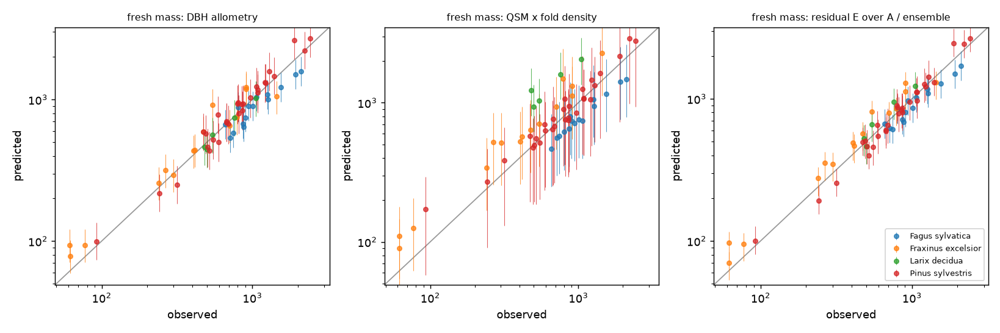

# Tree World Model v1 — evaluation results

All numbers are out-of-sample (outer cross-validation folds). Intervals are split-conformal
90 % intervals calibrated by an inner CV inside each training fold. relMAE and bias are
per-tree relative errors in %; total_bias compares summed predictions with summed observations.

Model selection caveat: around 25 models are scored on the same outer folds. The error of
whichever model looks best is therefore slightly optimistic; compare model families and
the consistency of a model across targets rather than single best numbers.

## 1. Belgian destructive harvest (65 trees, 4 species, 5 sites)

Targets are harvested quantities. leave_one_site_out holds out a whole site; because every
site is a single species except the two pine sites, this is close to leave-one-species-out.
within_site_5fold is the optimistic bound (the test trees' sites and species are in training).

### Ablation, relMAE % — leave_one_site_out, inventory DBH/height

| row | fresh_mass_total_kg | agb_dry_kg | volume_total_m3 | volume_stem_m3 |
|---|---|---|---|---|
| allometry A (DBH) | 16.4 | 20.0 | 10.9 | 15.8 |
| allometry B (DBH+H+leaf type) | 23.0 | 12.5 | 12.0 | 16.4 |
| residual B | 22.8 | 12.6 | 11.9 | 16.3 |
| residual C | 24.1 | 12.6 | 11.9 | 15.1 |
| residual D | 21.6 | 11.0 | 10.2 | 14.2 |
| residual E | 20.5 | 11.1 | 9.5 | 14.3 |
| residual D over A | 15.4 | 10.1 | 9.2 | 12.8 |
| residual E over A | 15.0 | 10.3 | 8.6 | 13.0 |

### Ablation, relMAE % — leave_one_site_out, scan DBH/height

| row | fresh_mass_total_kg | agb_dry_kg | volume_total_m3 | volume_stem_m3 |
|---|---|---|---|---|
| allometry A (DBH) | 14.8 | 17.5 | 10.6 | 18.3 |
| allometry B (DBH+H+leaf type) | 22.3 | 14.8 | 13.0 | 17.7 |
| residual B | 21.9 | 14.2 | 12.6 | 18.4 |
| residual C | 21.6 | 15.8 | 12.8 | 13.7 |
| residual D | 17.1 | 14.5 | 9.8 | 12.8 |
| residual E | 19.5 | 12.8 | 9.0 | 13.7 |
| residual D over A | 11.4 | 11.1 | 8.3 | 11.8 |
| residual E over A | 13.9 | 9.8 | 7.7 | 12.3 |

### Ablation, relMAE % — within_site_5fold, inventory DBH/height

| row | fresh_mass_total_kg | agb_dry_kg | volume_total_m3 | volume_stem_m3 |
|---|---|---|---|---|
| allometry A (DBH) | 14.2 | 15.7 | 10.7 | 14.4 |
| allometry B (DBH+H+leaf type) | 13.3 | 10.7 | 10.2 | 11.8 |
| residual B | 13.4 | 10.9 | 10.0 | 11.6 |
| residual C | 12.9 | 10.6 | 9.9 | 10.4 |
| residual D | 12.1 | 9.8 | 9.0 | 10.2 |
| residual E | 11.9 | 9.1 | 8.3 | 9.9 |
| residual D over A | 11.4 | 9.8 | 9.2 | 9.8 |
| residual E over A | 10.9 | 9.6 | 8.4 | 9.7 |

### Ablation, relMAE % — within_site_5fold, scan DBH/height

| row | fresh_mass_total_kg | agb_dry_kg | volume_total_m3 | volume_stem_m3 |
|---|---|---|---|---|
| allometry A (DBH) | 13.0 | 14.8 | 10.7 | 15.3 |
| allometry B (DBH+H+leaf type) | 13.3 | 11.9 | 10.5 | 12.0 |
| residual B | 12.8 | 11.9 | 10.3 | 12.4 |
| residual C | 12.7 | 12.0 | 10.2 | 10.2 |
| residual D | 10.7 | 10.7 | 8.0 | 10.4 |
| residual E | 10.2 | 9.9 | 6.9 | 10.1 |
| residual D over A | 10.4 | 10.3 | 8.3 | 10.0 |
| residual E over A | 9.8 | 9.9 | 6.8 | 9.8 |

### fresh_mass_total_kg — leave_one_site_out, inventory (all models)

| model | n | relMAE_pct | bias_pct | total_bias_pct | log_RMSE | coverage90 | interval_width_pct |
|---|---|---|---|---|---|---|---|
| residual E over A / ensemble | 65 | 15.04 | 1.96 | -0.17 | 0.18 | 0.83 | 62.44 |
| residual D over A / ensemble | 65 | 15.42 | 3.12 | 0.34 | 0.19 | 0.83 | 63.84 |
| residual E over A / ridge | 65 | 15.99 | 0.99 | 0.04 | 0.21 | 0.82 | 66.35 |
| allometry A (DBH) | 65 | 16.39 | 3.84 | 0.97 | 0.2 | 0.8 | 71.54 |
| residual D over A / ridge | 65 | 17.59 | 4.57 | 2.13 | 0.21 | 0.82 | 63.42 |
| QSM x measured density (oracle) | 65 | 18.4 | 4.19 | 0.8 | 0.23 | 0.92 | 171.2 |
| residual E / ridge | 65 | 18.82 | -0.33 | -2.39 | 0.23 | 0.82 | 69.64 |
| residual E / ensemble | 65 | 20.5 | 3.2 | -0.68 | 0.23 | 0.78 | 66.27 |
| residual D / ridge | 65 | 20.75 | 4.57 | 0.69 | 0.24 | 0.82 | 68.46 |
| residual D / ensemble | 65 | 21.55 | 4.76 | 0.21 | 0.25 | 0.78 | 68.52 |
| residual B / gp | 65 | 22.33 | 7.05 | 0.68 | 0.26 | 0.75 | 77.71 |
| residual D / gp | 65 | 22.36 | 5.03 | -0.59 | 0.26 | 0.78 | 72.2 |
| residual C / gp | 65 | 22.77 | 5.7 | -0.31 | 0.26 | 0.77 | 71.44 |
| residual B / ensemble | 65 | 22.81 | 6.68 | 0.43 | 0.26 | 0.74 | 75.65 |
| residual D / xgb | 65 | 22.92 | 5.37 | 1.1 | 0.26 | 0.82 | 71.13 |
| allometry B (DBH+H+leaf type) | 65 | 22.98 | 6.59 | 0.58 | 0.27 | 0.77 | 77.86 |
| residual B / ridge | 65 | 22.98 | 6.59 | 0.58 | 0.27 | 0.77 | 77.86 |
| residual E / gp | 65 | 23.15 | 5.71 | 0.03 | 0.26 | 0.77 | 74.43 |
| residual B / xgb | 65 | 23.61 | 6.62 | 0.22 | 0.27 | 0.75 | 80.11 |
| residual E / xgb | 65 | 23.71 | 6.4 | 1.7 | 0.26 | 0.78 | 70.73 |
| residual C / ensemble | 65 | 24.08 | 6.64 | 0.64 | 0.27 | 0.75 | 70.38 |
| residual C / ridge | 65 | 24.37 | 7.9 | 1.88 | 0.27 | 0.75 | 70.8 |
| residual C / xgb | 65 | 25.63 | 6.79 | 0.78 | 0.28 | 0.75 | 74.26 |
| QSM x fold density + residual E / ensemble | 65 | 27.22 | 13.72 | 10.92 | 0.29 | 0.94 | 105.39 |
| QSM x fold density | 65 | 32.32 | 19.23 | 10.12 | 0.34 | 0.92 | 122.4 |

### agb_dry_kg — leave_one_site_out, inventory (all models)

| model | n | relMAE_pct | bias_pct | total_bias_pct | log_RMSE | coverage90 | interval_width_pct |
|---|---|---|---|---|---|---|---|
| residual D over A / ensemble | 65 | 10.08 | 2.76 | 1.95 | 0.13 | 0.95 | 62.0 |
| residual E over A / ensemble | 65 | 10.28 | 3.12 | 2.35 | 0.12 | 0.98 | 47.46 |
| residual E / ridge | 65 | 10.99 | -1.41 | -0.32 | 0.15 | 0.88 | 53.72 |
| residual D / ensemble | 65 | 11.03 | 4.05 | 2.94 | 0.14 | 0.97 | 57.45 |
| residual E / ensemble | 65 | 11.08 | 2.22 | 1.93 | 0.14 | 0.97 | 56.37 |
| residual E / gp | 65 | 11.62 | 3.88 | 2.6 | 0.15 | 0.97 | 65.02 |
| residual D / xgb | 65 | 11.94 | 4.44 | 2.9 | 0.15 | 0.94 | 58.13 |
| residual D / gp | 65 | 11.98 | 4.23 | 2.44 | 0.15 | 0.97 | 63.86 |
| residual C / gp | 65 | 12.35 | 4.53 | 2.05 | 0.15 | 0.95 | 65.46 |
| residual C / ridge | 65 | 12.48 | 4.96 | 2.38 | 0.15 | 0.95 | 67.17 |
| residual B / gp | 65 | 12.48 | 4.96 | 2.35 | 0.15 | 0.95 | 66.48 |
| residual B / ridge | 65 | 12.48 | 4.96 | 2.35 | 0.15 | 0.95 | 66.48 |
| allometry B (DBH+H+leaf type) | 65 | 12.48 | 4.96 | 2.35 | 0.15 | 0.95 | 66.48 |
| residual B / ensemble | 65 | 12.59 | 5.18 | 2.43 | 0.15 | 0.95 | 66.57 |
| residual C / ensemble | 65 | 12.64 | 4.77 | 2.15 | 0.16 | 0.95 | 66.71 |
| residual D / ridge | 65 | 12.79 | 4.69 | 4.39 | 0.16 | 0.94 | 65.1 |
| residual B / xgb | 65 | 13.0 | 5.81 | 2.76 | 0.16 | 0.97 | 68.32 |
| residual D over A / ridge | 65 | 13.32 | 5.81 | 5.4 | 0.17 | 0.91 | 72.73 |
| residual E / xgb | 65 | 13.36 | 5.39 | 4.35 | 0.17 | 0.94 | 58.5 |
| QSM x fold density + residual E / ensemble | 65 | 13.97 | 9.14 | 7.94 | 0.17 | 0.92 | 64.34 |
| residual C / xgb | 65 | 14.08 | 5.13 | 2.3 | 0.18 | 0.92 | 61.21 |
| residual E over A / ridge | 65 | 14.94 | 7.09 | 6.84 | 0.18 | 0.92 | 56.25 |
| QSM x fold density | 65 | 17.79 | 13.8 | 11.13 | 0.22 | 0.92 | 88.61 |
| QSM x basic density (reported) | 65 | 18.47 | 4.22 | 2.37 | 0.23 | 0.92 | 170.06 |
| allometry A (DBH) | 65 | 20.04 | 5.1 | 2.05 | 0.23 | 0.88 | 69.0 |
| published allometry + residual E / ensemble | 65 | 20.89 | 4.42 | 1.58 | 0.26 | 0.94 | 93.26 |
| published allometry (reported) | 65 | 36.5 | 12.93 | 9.81 | 0.38 | 0.88 | 108.52 |

### volume_total_m3 — leave_one_site_out, inventory (all models)

| model | n | relMAE_pct | bias_pct | total_bias_pct | log_RMSE | coverage90 | interval_width_pct |
|---|---|---|---|---|---|---|---|
| residual E over A / ensemble | 65 | 8.61 | 0.22 | -0.08 | 0.11 | 0.94 | 38.56 |
| residual D over A / ensemble | 65 | 9.25 | 0.57 | -0.14 | 0.11 | 0.91 | 43.97 |
| residual E / ensemble | 65 | 9.49 | 0.41 | -0.52 | 0.11 | 0.92 | 37.69 |
| residual E / xgb | 65 | 10.1 | 1.86 | 0.44 | 0.13 | 0.86 | 39.55 |
| residual E / gp | 65 | 10.14 | 0.96 | -0.89 | 0.12 | 0.92 | 43.18 |
| residual D / ensemble | 65 | 10.25 | 0.59 | -0.46 | 0.12 | 0.92 | 42.63 |
| residual D / gp | 65 | 10.4 | 0.06 | -1.8 | 0.13 | 0.92 | 45.9 |
| residual D / xgb | 65 | 10.48 | 1.57 | 0.56 | 0.13 | 0.91 | 45.4 |
| allometry A (DBH) | 65 | 10.92 | 1.61 | -0.05 | 0.13 | 0.91 | 41.01 |
| residual E / ridge | 65 | 11.17 | -0.01 | 0.07 | 0.17 | 0.91 | 43.15 |
| residual D over A / ridge | 65 | 11.43 | 1.71 | 1.57 | 0.14 | 0.95 | 42.34 |
| residual C / gp | 65 | 11.7 | 1.37 | -1.12 | 0.14 | 0.94 | 46.65 |
| residual E over A / ridge | 65 | 11.78 | -0.17 | 0.57 | 0.18 | 0.91 | 53.49 |
| residual B / gp | 65 | 11.83 | 1.87 | -0.67 | 0.15 | 0.92 | 48.83 |
| residual C / ensemble | 65 | 11.91 | 1.41 | -1.08 | 0.14 | 0.86 | 45.29 |
| residual B / ensemble | 65 | 11.93 | 1.74 | -0.78 | 0.15 | 0.92 | 49.16 |
| allometry B (DBH+H+leaf type) | 65 | 11.96 | 1.86 | -0.58 | 0.15 | 0.92 | 48.83 |
| residual B / ridge | 65 | 11.96 | 1.86 | -0.58 | 0.15 | 0.92 | 48.83 |
| residual B / xgb | 65 | 12.12 | 1.65 | -0.96 | 0.15 | 0.88 | 51.26 |
| residual C / xgb | 65 | 12.14 | 1.48 | -1.2 | 0.14 | 0.86 | 46.16 |
| residual D / ridge | 65 | 12.15 | 0.98 | 0.57 | 0.15 | 0.88 | 44.95 |
| residual C / ridge | 65 | 12.45 | 1.65 | -0.67 | 0.15 | 0.91 | 48.31 |
| QSM x fold density | 65 | 18.38 | 13.51 | 10.85 | 0.24 | 0.92 | 121.53 |
| QSM volume (raw) | 65 | 18.4 | 4.19 | 0.92 | 0.23 | 0.92 | 171.2 |
| QSM x fold density + residual E / ensemble | 65 | 18.86 | 11.39 | 11.44 | 0.23 | 0.92 | 88.55 |

### volume_stem_m3 — leave_one_site_out, inventory (all models)

| model | n | relMAE_pct | bias_pct | total_bias_pct | log_RMSE | coverage90 | interval_width_pct |
|---|---|---|---|---|---|---|---|
| point-cloud stem volume x fold factor | 64 | 11.33 | 0.05 | 2.68 | 0.15 | 0.94 | 45.7 |
| residual D over A / ensemble | 64 | 12.83 | 2.83 | -0.43 | 0.17 | 0.91 | 54.41 |
| residual E over A / ensemble | 64 | 13.04 | 2.46 | -0.99 | 0.17 | 0.91 | 53.69 |
| residual D / ridge | 64 | 13.37 | 2.19 | -0.38 | 0.17 | 0.88 | 57.06 |
| residual D over A / ridge | 64 | 13.54 | 1.43 | -1.55 | 0.17 | 0.88 | 63.27 |
| residual E / xgb | 64 | 13.57 | 1.89 | 0.08 | 0.17 | 0.91 | 52.81 |
| residual E / ridge | 64 | 13.8 | 1.2 | -1.89 | 0.17 | 0.89 | 48.33 |
| QSM stem volume (raw) | 64 | 13.89 | 2.3 | 1.29 | 0.16 | 0.88 | 75.2 |
| residual D / xgb | 64 | 13.92 | 2.5 | 0.66 | 0.17 | 0.92 | 55.44 |
| residual D / ensemble | 64 | 14.19 | 2.39 | -0.1 | 0.17 | 0.91 | 52.76 |
| residual C / xgb | 64 | 14.24 | 2.38 | 1.03 | 0.17 | 0.86 | 50.44 |
| point-cloud stem volume (raw) | 64 | 14.29 | 2.74 | 2.95 | 0.17 | 0.92 | 77.93 |
| residual E / ensemble | 64 | 14.33 | 1.66 | -1.0 | 0.17 | 0.84 | 48.31 |
| residual C / ensemble | 64 | 15.08 | 2.42 | 0.35 | 0.18 | 0.91 | 57.09 |
| residual C / ridge | 64 | 15.14 | 2.59 | 0.53 | 0.18 | 0.92 | 62.64 |
| residual E over A / ridge | 64 | 15.21 | 0.13 | -3.57 | 0.2 | 0.86 | 70.9 |
| allometry A (DBH) | 64 | 15.77 | 4.21 | 0.14 | 0.2 | 0.89 | 67.31 |
| residual B / xgb | 64 | 16.27 | 3.48 | 0.8 | 0.19 | 0.89 | 62.96 |
| residual B / ensemble | 64 | 16.29 | 3.17 | 0.22 | 0.19 | 0.92 | 58.59 |
| residual B / ridge | 64 | 16.36 | 3.11 | 0.03 | 0.19 | 0.94 | 60.02 |
| allometry B (DBH+H+leaf type) | 64 | 16.36 | 3.11 | 0.03 | 0.19 | 0.94 | 60.02 |
| residual B / gp | 64 | 16.36 | 3.11 | 0.03 | 0.19 | 0.94 | 60.02 |
| residual D / gp | 64 | 16.75 | 3.0 | -0.05 | 0.2 | 0.92 | 60.81 |
| residual E / gp | 64 | 16.84 | 2.44 | -0.63 | 0.2 | 0.91 | 61.2 |
| residual C / gp | 64 | 17.08 | 2.77 | -0.05 | 0.2 | 0.91 | 59.82 |

### fresh_mass_total_kg — leave_one_site_out, scan-only (all models)

| model | n | relMAE_pct | bias_pct | total_bias_pct | log_RMSE | coverage90 | interval_width_pct |
|---|---|---|---|---|---|---|---|
| residual D over A / ensemble | 65 | 11.44 | 2.36 | 1.0 | 0.14 | 0.94 | 47.29 |
| residual D over A / ridge | 65 | 12.02 | 2.83 | 1.79 | 0.14 | 0.94 | 51.32 |
| residual E over A / ensemble | 65 | 13.85 | 2.94 | 0.47 | 0.16 | 0.88 | 47.4 |
| allometry A (DBH) | 65 | 14.76 | 3.12 | 0.64 | 0.18 | 0.82 | 58.69 |
| residual D / ridge | 65 | 15.03 | 2.44 | 0.88 | 0.17 | 0.95 | 57.72 |
| residual E over A / ridge | 65 | 16.52 | 4.99 | 2.04 | 0.2 | 0.88 | 57.58 |
| residual D / ensemble | 65 | 17.12 | 3.03 | 0.31 | 0.19 | 0.94 | 55.92 |
| residual D / gp | 65 | 18.37 | 3.77 | -0.15 | 0.21 | 0.91 | 59.69 |
| QSM x measured density (oracle) | 65 | 18.4 | 4.19 | 0.8 | 0.23 | 0.92 | 171.2 |
| residual D / xgb | 65 | 19.12 | 3.77 | 0.88 | 0.21 | 0.88 | 59.97 |
| residual E / ensemble | 65 | 19.52 | 4.03 | -0.22 | 0.22 | 0.89 | 52.48 |
| residual E / gp | 65 | 19.54 | 3.72 | -0.82 | 0.22 | 0.86 | 60.8 |
| residual E / xgb | 65 | 19.72 | 4.7 | 0.51 | 0.22 | 0.88 | 60.37 |
| residual E / ridge | 65 | 19.86 | 4.33 | 0.21 | 0.22 | 0.91 | 56.1 |
| residual C / gp | 65 | 20.9 | 4.96 | 0.15 | 0.23 | 0.86 | 63.81 |
| residual C / ensemble | 65 | 21.64 | 5.58 | 0.47 | 0.24 | 0.83 | 63.86 |
| residual B / gp | 65 | 21.93 | 5.18 | -0.06 | 0.24 | 0.85 | 66.0 |
| residual B / ensemble | 65 | 21.95 | 5.48 | 0.5 | 0.24 | 0.89 | 69.78 |
| residual C / xgb | 65 | 22.02 | 5.73 | 0.13 | 0.25 | 0.83 | 63.82 |
| residual C / ridge | 65 | 22.03 | 6.55 | 1.58 | 0.24 | 0.83 | 62.21 |
| residual B / xgb | 65 | 22.31 | 6.23 | 1.64 | 0.24 | 0.91 | 74.71 |
| residual B / ridge | 65 | 22.32 | 5.29 | 0.13 | 0.25 | 0.83 | 66.52 |
| allometry B (DBH+H+leaf type) | 65 | 22.32 | 5.29 | 0.13 | 0.25 | 0.83 | 66.52 |
| QSM x fold density + residual E / ensemble | 65 | 24.53 | 13.45 | 10.21 | 0.26 | 0.94 | 110.48 |
| QSM x fold density | 65 | 32.32 | 19.23 | 10.12 | 0.34 | 0.92 | 122.4 |

### agb_dry_kg — leave_one_site_out, scan-only (all models)

| model | n | relMAE_pct | bias_pct | total_bias_pct | log_RMSE | coverage90 | interval_width_pct |
|---|---|---|---|---|---|---|---|
| residual E over A / ensemble | 65 | 9.75 | 3.01 | 1.73 | 0.12 | 0.94 | 45.36 |
| residual D over A / ensemble | 65 | 11.1 | 3.21 | 3.18 | 0.14 | 0.95 | 57.77 |
| residual D over A / ridge | 65 | 12.37 | 3.96 | 4.07 | 0.16 | 0.94 | 64.36 |
| residual E over A / ridge | 65 | 12.53 | 7.56 | 5.58 | 0.15 | 0.92 | 54.08 |
| residual E / ensemble | 65 | 12.82 | 4.62 | 3.25 | 0.15 | 0.94 | 51.87 |
| residual E / ridge | 65 | 12.99 | 7.01 | 5.15 | 0.16 | 0.95 | 56.66 |
| residual E / gp | 65 | 13.41 | 3.65 | 2.62 | 0.16 | 0.95 | 55.34 |
| residual B / xgb | 65 | 13.81 | 5.11 | 2.82 | 0.17 | 0.94 | 66.44 |
| residual B / ensemble | 65 | 14.2 | 4.9 | 2.64 | 0.17 | 0.91 | 60.85 |
| residual D / ensemble | 65 | 14.45 | 4.84 | 4.28 | 0.17 | 0.91 | 54.77 |
| residual B / ridge | 65 | 14.79 | 4.92 | 2.68 | 0.17 | 0.91 | 59.7 |
| allometry B (DBH+H+leaf type) | 65 | 14.79 | 4.92 | 2.68 | 0.17 | 0.91 | 59.7 |
| residual B / gp | 65 | 14.79 | 4.92 | 2.68 | 0.17 | 0.91 | 59.7 |
| QSM x fold density + residual E / ensemble | 65 | 15.1 | 10.22 | 8.29 | 0.18 | 0.92 | 79.37 |
| residual C / gp | 65 | 15.23 | 5.22 | 3.22 | 0.18 | 0.91 | 59.67 |
| residual D / xgb | 65 | 15.35 | 4.96 | 3.52 | 0.18 | 0.91 | 55.08 |
| residual C / ridge | 65 | 15.42 | 4.91 | 2.84 | 0.18 | 0.88 | 59.64 |
| residual D / ridge | 65 | 15.56 | 4.67 | 4.98 | 0.18 | 0.91 | 62.85 |
| residual E / xgb | 65 | 15.66 | 4.81 | 3.37 | 0.18 | 0.94 | 52.4 |
| residual C / ensemble | 65 | 15.82 | 5.19 | 2.78 | 0.18 | 0.88 | 59.17 |
| residual D / gp | 65 | 16.11 | 5.78 | 5.02 | 0.18 | 0.94 | 56.92 |
| residual C / xgb | 65 | 17.4 | 5.83 | 2.64 | 0.2 | 0.91 | 60.36 |
| allometry A (DBH) | 65 | 17.53 | 4.4 | 1.84 | 0.21 | 0.92 | 69.19 |
| QSM x fold density | 65 | 17.79 | 13.8 | 11.13 | 0.22 | 0.92 | 88.61 |
| QSM x basic density (reported) | 65 | 18.47 | 4.22 | 2.37 | 0.23 | 0.92 | 170.06 |
| published allometry + residual E / ensemble | 65 | 22.12 | 5.24 | 2.39 | 0.25 | 0.94 | 93.99 |
| published allometry (reported) | 65 | 36.5 | 12.93 | 9.81 | 0.38 | 0.88 | 108.52 |

### volume_total_m3 — leave_one_site_out, scan-only (all models)

| model | n | relMAE_pct | bias_pct | total_bias_pct | log_RMSE | coverage90 | interval_width_pct |
|---|---|---|---|---|---|---|---|
| residual E over A / ensemble | 65 | 7.68 | 2.78 | 1.45 | 0.1 | 0.91 | 38.29 |
| residual E / gp | 65 | 7.84 | -0.02 | -1.12 | 0.1 | 0.92 | 34.81 |
| residual D over A / ensemble | 65 | 8.33 | 1.28 | 0.6 | 0.11 | 0.91 | 40.27 |
| residual E / ensemble | 65 | 9.03 | 2.38 | 1.32 | 0.11 | 0.94 | 38.64 |
| residual D / ensemble | 65 | 9.82 | 0.87 | 0.56 | 0.12 | 0.88 | 42.61 |
| residual D over A / ridge | 65 | 9.92 | 2.01 | 2.2 | 0.13 | 0.91 | 52.99 |
| residual D / ridge | 65 | 10.06 | 1.18 | 1.74 | 0.14 | 0.91 | 56.34 |
| residual D / gp | 65 | 10.32 | 1.18 | 0.25 | 0.13 | 0.94 | 42.81 |
| allometry A (DBH) | 65 | 10.58 | 1.52 | -0.29 | 0.13 | 0.91 | 43.26 |
| residual E / xgb | 65 | 10.67 | 1.08 | -0.31 | 0.13 | 0.86 | 36.36 |
| residual D / xgb | 65 | 10.74 | 1.32 | 0.58 | 0.13 | 0.91 | 44.13 |
| residual E over A / ridge | 65 | 11.78 | 6.9 | 5.45 | 0.16 | 0.94 | 57.33 |
| residual E / ridge | 65 | 12.19 | 7.67 | 6.9 | 0.15 | 0.98 | 54.38 |
| residual B / xgb | 65 | 12.58 | 1.83 | 0.01 | 0.16 | 0.86 | 58.21 |
| residual C / xgb | 65 | 12.59 | 2.01 | -0.64 | 0.15 | 0.91 | 49.6 |
| residual B / ensemble | 65 | 12.6 | 1.55 | -0.32 | 0.15 | 0.89 | 54.61 |
| residual C / ensemble | 65 | 12.76 | 1.84 | -0.16 | 0.15 | 0.88 | 49.65 |
| residual C / gp | 65 | 12.87 | 2.11 | 0.5 | 0.15 | 0.86 | 51.34 |
| residual B / gp | 65 | 12.96 | 1.5 | -0.39 | 0.15 | 0.85 | 52.82 |
| residual B / ridge | 65 | 12.96 | 1.5 | -0.39 | 0.15 | 0.85 | 52.82 |
| allometry B (DBH+H+leaf type) | 65 | 12.96 | 1.5 | -0.39 | 0.15 | 0.85 | 52.82 |
| residual C / ridge | 65 | 13.53 | 1.67 | -0.08 | 0.16 | 0.88 | 53.66 |
| QSM x fold density + residual E / ensemble | 65 | 15.84 | 9.41 | 8.51 | 0.2 | 0.92 | 83.68 |
| QSM x fold density | 65 | 18.38 | 13.51 | 10.85 | 0.24 | 0.92 | 121.53 |
| QSM volume (raw) | 65 | 18.4 | 4.19 | 0.92 | 0.23 | 0.92 | 171.2 |

### volume_stem_m3 — leave_one_site_out, scan-only (all models)

| model | n | relMAE_pct | bias_pct | total_bias_pct | log_RMSE | coverage90 | interval_width_pct |
|---|---|---|---|---|---|---|---|
| point-cloud stem volume x fold factor | 64 | 11.33 | 0.05 | 2.68 | 0.15 | 0.94 | 45.7 |
| residual D / ridge | 64 | 11.57 | 2.24 | 0.34 | 0.15 | 0.92 | 56.8 |
| residual D over A / ensemble | 64 | 11.8 | 1.98 | -1.12 | 0.15 | 0.94 | 52.09 |
| residual E over A / ensemble | 64 | 12.28 | 1.73 | -1.88 | 0.16 | 0.92 | 53.56 |
| residual D over A / ridge | 64 | 12.37 | 0.55 | -1.97 | 0.16 | 0.91 | 56.42 |
| residual C / ridge | 64 | 12.39 | 1.16 | -0.35 | 0.15 | 0.88 | 59.54 |
| residual D / ensemble | 64 | 12.81 | 1.95 | -0.17 | 0.16 | 0.91 | 60.48 |
| residual D / xgb | 64 | 13.01 | 2.25 | 0.69 | 0.16 | 0.91 | 61.83 |
| residual E / ridge | 64 | 13.11 | -0.18 | -3.22 | 0.16 | 0.91 | 52.34 |
| residual E / xgb | 64 | 13.23 | 1.58 | -0.48 | 0.16 | 0.92 | 54.98 |
| residual E / ensemble | 64 | 13.73 | 1.17 | -1.61 | 0.17 | 0.89 | 54.94 |
| residual C / xgb | 64 | 13.73 | 1.17 | -0.36 | 0.17 | 0.89 | 57.15 |
| residual C / ensemble | 64 | 13.75 | 1.54 | -0.21 | 0.17 | 0.89 | 60.7 |
| QSM stem volume (raw) | 64 | 13.89 | 2.3 | 1.29 | 0.16 | 0.88 | 75.2 |
| point-cloud stem volume (raw) | 64 | 14.29 | 2.74 | 2.95 | 0.17 | 0.92 | 77.93 |
| residual E over A / ridge | 64 | 14.42 | -1.09 | -4.18 | 0.18 | 0.94 | 62.28 |
| residual D / gp | 64 | 15.57 | 1.91 | -0.96 | 0.19 | 0.91 | 64.01 |
| residual C / gp | 64 | 15.85 | 2.7 | 0.47 | 0.19 | 0.88 | 65.37 |
| residual E / gp | 64 | 17.57 | 3.06 | -0.16 | 0.2 | 0.91 | 60.94 |
| allometry B (DBH+H+leaf type) | 64 | 17.72 | 3.08 | 0.2 | 0.21 | 0.89 | 64.27 |
| residual B / ridge | 64 | 17.72 | 3.08 | 0.2 | 0.21 | 0.89 | 64.27 |
| residual B / gp | 64 | 17.78 | 3.1 | 0.2 | 0.21 | 0.89 | 61.96 |
| allometry A (DBH) | 64 | 18.25 | 5.05 | 0.36 | 0.22 | 0.88 | 85.02 |
| residual B / ensemble | 64 | 18.41 | 3.31 | 0.18 | 0.22 | 0.89 | 63.29 |
| residual B / xgb | 64 | 20.07 | 3.98 | 0.39 | 0.24 | 0.86 | 75.7 |

## 2. Global harvested-biomass compilation — dry AGB, leave-one-study-out (9 studies)

Corrects each study's reported allometric AGB with a learned log-residual. Trees with missing
inputs are dropped so that every model is scored on the same trees.

| model | n | relMAE_pct | bias_pct | total_bias_pct | log_RMSE | coverage90 | interval_width_pct |
|---|---|---|---|---|---|---|---|
| published + residual E / ensemble | 373 | 17.35 | 4.69 | 1.84 | 0.22 | 0.91 | 68.91 |
| TLS-QSM + residual E / ensemble | 373 | 17.66 | 5.13 | 3.61 | 0.22 | 0.91 | 67.0 |
| published + residual E / xgb | 373 | 18.0 | 5.22 | -0.13 | 0.22 | 0.9 | 69.94 |
| published + residual E / ridge | 373 | 18.03 | 5.31 | 9.7 | 0.22 | 0.91 | 72.0 |
| published + residual E / gp | 373 | 19.47 | 5.35 | -1.09 | 0.24 | 0.91 | 76.47 |
| geometric mean of allometry and QSM | 373 | 20.39 | 6.34 | -7.98 | 0.25 | 0.9 | 90.29 |
| TLS-QSM (reported) | 373 | 21.94 | 8.72 | -6.08 | 0.29 | 0.9 | 103.36 |
| fitted allometry B (DBH+H+leaf type+foliage) | 373 | 30.51 | 13.76 | 3.53 | 0.36 | 0.88 | 130.33 |
| published + residual B / ridge | 373 | 30.83 | 13.04 | 13.98 | 0.35 | 0.88 | 112.78 |
| published + residual B / ensemble | 373 | 31.67 | 12.89 | 7.76 | 0.36 | 0.89 | 108.12 |
| published + residual B / gp | 373 | 32.76 | 12.87 | 4.97 | 0.36 | 0.9 | 109.3 |
| published allometry (reported) | 373 | 32.9 | 13.39 | -3.58 | 0.37 | 0.9 | 121.14 |
| published + residual B / xgb | 373 | 34.11 | 14.7 | 6.34 | 0.38 | 0.9 | 114.31 |
| fitted allometry A (DBH) | 373 | 43.97 | 24.84 | 3.79 | 0.48 | 0.87 | 188.58 |

## 3. BioDiv-3DTrees — QSM volume (reconstructed target), 5-fold grouped by plot

The target is TreeQSM volume, not a physical measurement, so this only shows whether drone
(ULS) crown geometry adds information beyond TLS DBH and height for predicting QSM volume.

| model | n | relMAE_pct | bias_pct | total_bias_pct | log_RMSE | coverage90 | interval_width_pct |
|---|---|---|---|---|---|---|---|
| residual D_tls_uls / ensemble | 1889 | 30.97 | 14.54 | 0.88 | 0.36 | 0.9 | 119.02 |
| residual D_tls_uls / xgb | 1889 | 31.53 | 14.95 | 1.5 | 0.37 | 0.9 | 119.03 |
| residual D_tls_uls / ridge | 1889 | 31.68 | 15.03 | 0.97 | 0.37 | 0.9 | 123.17 |
| residual D_tls / ridge | 1889 | 31.76 | 15.33 | 1.23 | 0.38 | 0.9 | 124.38 |
| residual D_tls / ensemble | 1889 | 32.09 | 15.75 | 1.39 | 0.38 | 0.9 | 124.63 |
| residual D_tls / xgb | 1889 | 32.87 | 16.52 | 1.81 | 0.39 | 0.89 | 127.04 |
| fitted allometry B (DBH+H+genus) | 1889 | 33.95 | 17.47 | 1.35 | 0.4 | 0.9 | 128.5 |
| fitted allometry A (DBH) | 1889 | 34.7 | 17.85 | 3.22 | 0.41 | 0.9 | 131.34 |

## Errors by species / study

| experiment | target | model | species_latin | n | relMAE_pct | bias_pct | coverage90 |
|---|---|---|---|---|---|---|---|
| belgian | fresh_mass_total_kg | allometry A (DBH) | Fagus sylvatica | 15 | 22.1 | -21.9 | 0.3 |
| belgian | fresh_mass_total_kg | allometry A (DBH) | Fraxinus excelsior | 15 | 19.9 | 17.5 | 0.8 |
| belgian | fresh_mass_total_kg | allometry A (DBH) | Larix decidua | 5 | 7.7 | -0.3 | 1.0 |
| belgian | fresh_mass_total_kg | allometry A (DBH) | Pinus sylvestris | 30 | 13.2 | 10.6 | 1.0 |
| belgian | fresh_mass_total_kg | residual E over A / ensemble | Fagus sylvatica | 15 | 18.8 | -18.8 | 0.4 |
| belgian | fresh_mass_total_kg | residual E over A / ensemble | Fraxinus excelsior | 15 | 25.2 | 23.0 | 0.9 |
| belgian | fresh_mass_total_kg | residual E over A / ensemble | Larix decidua | 5 | 15.8 | 12.6 | 1.0 |
| belgian | fresh_mass_total_kg | residual E over A / ensemble | Pinus sylvestris | 30 | 8.0 | 0.0 | 1.0 |
| belgian | fresh_mass_total_kg | QSM x fold density | Fagus sylvatica | 15 | 23.5 | -23.5 | 1.0 |
| belgian | fresh_mass_total_kg | QSM x fold density | Fraxinus excelsior | 15 | 51.9 | 51.9 | 1.0 |
| belgian | fresh_mass_total_kg | QSM x fold density | Larix decidua | 5 | 108.2 | 108.2 | 0.0 |
| belgian | fresh_mass_total_kg | QSM x fold density | Pinus sylvestris | 30 | 14.3 | 9.4 | 1.0 |
| belgian | agb_dry_kg | allometry A (DBH) | Fagus sylvatica | 15 | 20.5 | -20.3 | 0.7 |
| belgian | agb_dry_kg | allometry A (DBH) | Fraxinus excelsior | 15 | 14.8 | -6.4 | 1.0 |
| belgian | agb_dry_kg | allometry A (DBH) | Larix decidua | 5 | 7.1 | -0.9 | 1.0 |
| belgian | agb_dry_kg | allometry A (DBH) | Pinus sylvestris | 30 | 24.6 | 24.6 | 0.9 |
| belgian | agb_dry_kg | residual E over A / ensemble | Fagus sylvatica | 15 | 7.1 | -4.6 | 1.0 |
| belgian | agb_dry_kg | residual E over A / ensemble | Fraxinus excelsior | 15 | 13.6 | 8.4 | 1.0 |
| belgian | agb_dry_kg | residual E over A / ensemble | Larix decidua | 5 | 11.5 | 7.4 | 0.8 |
| belgian | agb_dry_kg | residual E over A / ensemble | Pinus sylvestris | 30 | 10.0 | 3.6 | 1.0 |
| belgian | agb_dry_kg | QSM x fold density | Fagus sylvatica | 15 | 9.4 | 3.6 | 1.0 |
| belgian | agb_dry_kg | QSM x fold density | Fraxinus excelsior | 15 | 20.6 | 20.4 | 1.0 |
| belgian | agb_dry_kg | QSM x fold density | Larix decidua | 5 | 80.4 | 80.4 | 0.0 |
| belgian | agb_dry_kg | QSM x fold density | Pinus sylvestris | 30 | 10.2 | 4.5 | 1.0 |
| belgian | volume_total_m3 | allometry A (DBH) | Fagus sylvatica | 15 | 13.0 | -7.5 | 0.8 |
| belgian | volume_total_m3 | allometry A (DBH) | Fraxinus excelsior | 15 | 15.2 | 7.5 | 0.8 |
| belgian | volume_total_m3 | allometry A (DBH) | Larix decidua | 5 | 7.7 | -4.5 | 1.0 |
| belgian | volume_total_m3 | allometry A (DBH) | Pinus sylvestris | 30 | 8.3 | 4.2 | 1.0 |
| belgian | volume_total_m3 | residual E over A / ensemble | Fagus sylvatica | 15 | 7.2 | -3.2 | 1.0 |
| belgian | volume_total_m3 | residual E over A / ensemble | Fraxinus excelsior | 15 | 12.0 | 4.0 | 0.7 |
| belgian | volume_total_m3 | residual E over A / ensemble | Larix decidua | 5 | 10.9 | 7.1 | 1.0 |
| belgian | volume_total_m3 | residual E over A / ensemble | Pinus sylvestris | 30 | 7.3 | -1.1 | 1.0 |
| belgian | volume_total_m3 | QSM x fold density | Fagus sylvatica | 15 | 6.4 | -4.5 | 1.0 |
| belgian | volume_total_m3 | QSM x fold density | Fraxinus excelsior | 15 | 16.6 | 16.3 | 1.0 |
| belgian | volume_total_m3 | QSM x fold density | Larix decidua | 5 | 101.3 | 101.3 | 0.0 |
| belgian | volume_total_m3 | QSM x fold density | Pinus sylvestris | 30 | 11.4 | 6.5 | 1.0 |
| belgian | volume_stem_m3 | allometry A (DBH) | Fagus sylvatica | 15 | 10.6 | 0.4 | 1.0 |
| belgian | volume_stem_m3 | allometry A (DBH) | Fraxinus excelsior | 14 | 32.2 | 30.9 | 0.6 |
| belgian | volume_stem_m3 | allometry A (DBH) | Larix decidua | 5 | 8.3 | 8.3 | 1.0 |
| belgian | volume_stem_m3 | allometry A (DBH) | Pinus sylvestris | 30 | 11.9 | -7.0 | 0.9 |
| belgian | volume_stem_m3 | residual E over A / ensemble | Fagus sylvatica | 15 | 11.4 | -8.9 | 1.0 |
| belgian | volume_stem_m3 | residual E over A / ensemble | Fraxinus excelsior | 14 | 26.8 | 24.9 | 0.6 |
| belgian | volume_stem_m3 | residual E over A / ensemble | Larix decidua | 5 | 11.7 | -11.3 | 1.0 |
| belgian | volume_stem_m3 | residual E over A / ensemble | Pinus sylvestris | 30 | 7.7 | -0.0 | 1.0 |
| ceda (by study) | agb_dry_kg | published allometry (reported) | Demol2021 | 65 | 28.7 | 9.6 | 0.9 |
| ceda (by study) | agb_dry_kg | published allometry (reported) | GdtM2017 | 29 | 27.0 | -20.1 | 0.9 |
| ceda (by study) | agb_dry_kg | published allometry (reported) | Hackenberg2015 | 24 | 59.9 | 54.1 | 0.6 |
| ceda (by study) | agb_dry_kg | published allometry (reported) | Kukenbrink2021 | 54 | 49.2 | 46.6 | 0.9 |
| ceda (by study) | agb_dry_kg | published allometry (reported) | Lau2019 | 26 | 31.6 | 13.8 | 0.9 |
| ceda (by study) | agb_dry_kg | published allometry (reported) | Lau2021 | 28 | 17.3 | -2.1 | 1.0 |
| ceda (by study) | agb_dry_kg | published allometry (reported) | Momo2017 | 61 | 35.6 | 34.0 | 1.0 |
| ceda (by study) | agb_dry_kg | published allometry (reported) | Stovall2017 | 21 | 12.9 | -0.5 | 1.0 |
| ceda (by study) | agb_dry_kg | published allometry (reported) | calders2015 | 65 | 27.3 | -18.7 | 0.9 |
| ceda (by study) | agb_dry_kg | TLS-QSM (reported) | Demol2021 | 65 | 21.6 | 19.4 | 0.9 |
| ceda (by study) | agb_dry_kg | TLS-QSM (reported) | GdtM2017 | 29 | 22.0 | -7.2 | 0.9 |
| ceda (by study) | agb_dry_kg | TLS-QSM (reported) | Hackenberg2015 | 24 | 18.6 | 11.3 | 1.0 |
| ceda (by study) | agb_dry_kg | TLS-QSM (reported) | Kukenbrink2021 | 54 | 25.4 | -3.1 | 0.9 |
| ceda (by study) | agb_dry_kg | TLS-QSM (reported) | Lau2019 | 26 | 30.0 | 13.8 | 0.8 |
| ceda (by study) | agb_dry_kg | TLS-QSM (reported) | Lau2021 | 28 | 32.2 | 19.5 | 0.8 |
| ceda (by study) | agb_dry_kg | TLS-QSM (reported) | Momo2017 | 61 | 10.8 | -3.2 | 1.0 |
| ceda (by study) | agb_dry_kg | TLS-QSM (reported) | Stovall2017 | 21 | 15.1 | -3.4 | 1.0 |
| ceda (by study) | agb_dry_kg | TLS-QSM (reported) | calders2015 | 65 | 25.7 | 22.4 | 0.9 |
| ceda (by study) | agb_dry_kg | published + residual E / ensemble | Demol2021 | 65 | 15.3 | 12.4 | 1.0 |
| ceda (by study) | agb_dry_kg | published + residual E / ensemble | GdtM2017 | 29 | 18.3 | -3.4 | 0.8 |
| ceda (by study) | agb_dry_kg | published + residual E / ensemble | Hackenberg2015 | 24 | 19.1 | 16.2 | 0.9 |
| ceda (by study) | agb_dry_kg | published + residual E / ensemble | Kukenbrink2021 | 54 | 17.2 | 6.1 | 0.9 |
| ceda (by study) | agb_dry_kg | published + residual E / ensemble | Lau2019 | 26 | 25.1 | 12.1 | 0.8 |
| ceda (by study) | agb_dry_kg | published + residual E / ensemble | Lau2021 | 28 | 18.7 | 6.6 | 0.9 |
| ceda (by study) | agb_dry_kg | published + residual E / ensemble | Momo2017 | 61 | 18.2 | 11.3 | 1.0 |
| ceda (by study) | agb_dry_kg | published + residual E / ensemble | Stovall2017 | 21 | 11.6 | -8.0 | 1.0 |
| ceda (by study) | agb_dry_kg | published + residual E / ensemble | calders2015 | 65 | 15.7 | -10.7 | 0.9 |

